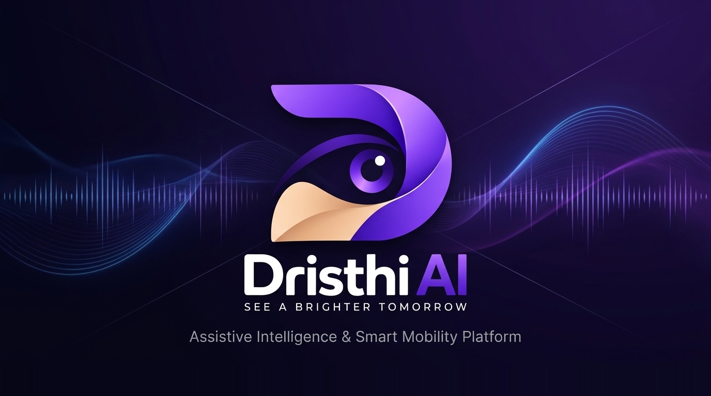
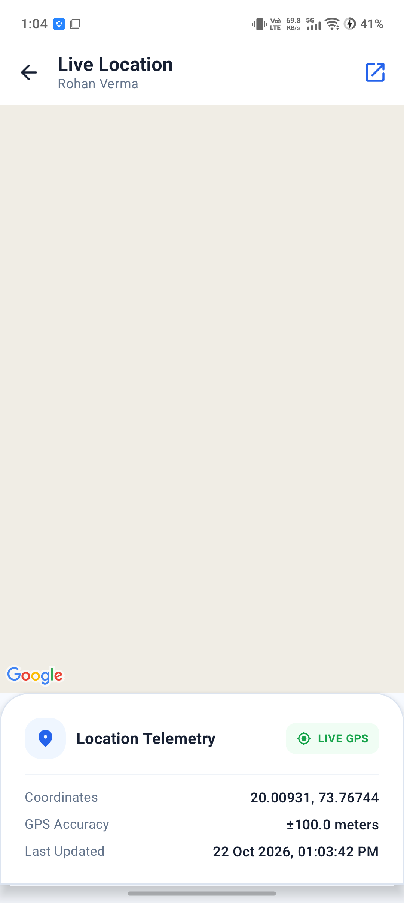
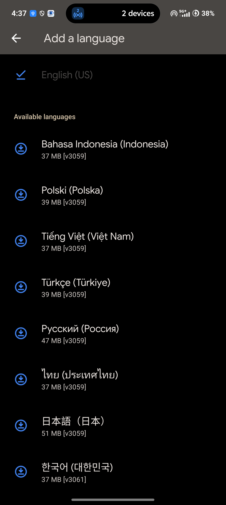
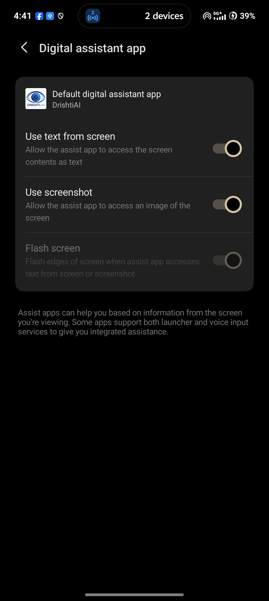
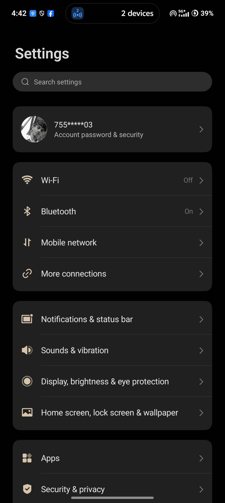
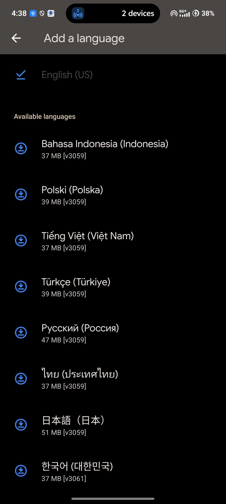

<div align="center">
  

  <br />

  [](LICENSE)
  [-green.svg)](docs/testing/device-compatibility.md)
  [](https://kotlinlang.org/)
  [](docs/android-app/accessibility.md)
  [](docs/backend/supabase-architecture.md)
  [](docs/hardware/smart-cane-overview.md)
  [](docs/testing/verification-results.md)
  [-blueviolet.svg)](CHANGELOG.md)

  ---

  # Drishti AI: Assistive Intelligence & Smart Mobility Platform
  ### *See a Brighter Tomorrow*

  ---

  **Drishti AI** is a comprehensive assistive technology platform that combines an accessible, voice-first Android application, an embedded Time-of-Flight (ToF) smart cane, local on-device computer vision, hands-free telephony, conversational scheduling, and a secure parent/caregiver monitoring system.

  Designed around the core principles of **Accessibility First**, **Offline-First Resilience**, and **Privacy & Security by Design**, Drishti AI empowers blind and visually impaired individuals to navigate unfamiliar physical environments with confidence, read printed materials independently, manage daily schedules, and maintain an emergency lifeline with family.

</div>

---

## 📑 Master Documentation Index

Drishti AI features an exhaustive documentation suite organized within the [`docs/`](docs/) directory:

| Architecture Domain | Specialized Documentation Links |
| :--- | :--- |
| **System Overview & Specs** | • [Project Overview](docs/project-overview.md)<br>• [Requirements & Feature Inventory](docs/requirements-and-features.md)<br>• [System Architecture & Data Flows](docs/system-architecture.md) |
| **Android Application** | • [App Architecture & Lifecycle](docs/android-app/app-architecture.md)<br>• [Multilingual Voice Assistant & Routing](docs/android-app/voice-assistant.md)<br>• [Computer Vision, OCR & Hazard Risk Engine](docs/android-app/vision-and-ocr.md)<br>• [Hands-Free Telephony & Call Control](docs/android-app/call-management.md)<br>• [Voice Calendar & Event Scheduling](docs/android-app/calendar-and-events.md)<br>• [Accessibility, Design Tokens & Ergonomics](docs/android-app/accessibility.md) |
| **Smart Cane Hardware** | • [Smart Cane System Overview](docs/hardware/smart-cane-overview.md)<br>• [VL53L0X Time-of-Flight Lidar & ESP32](docs/hardware/esp32-vl53l0x.md)<br>• [Wiring Schematics & Power Management](docs/hardware/wiring-and-power.md)<br>• [Nordic UART BLE Telemetry Protocol](docs/hardware/ble-telemetry.md) |
| **Cloud Backend & Security** | • [Supabase Cloud Architecture](docs/backend/supabase-architecture.md)<br>• [PostgreSQL Database Schema & Data Dictionary](docs/backend/database-schema.md)<br>• [Authentication, Roles & RLS Matrix](docs/backend/authentication-and-roles.md)<br>• [Cryptographic Guardian Pairing Ceremony](docs/backend/guardian-pairing.md)<br>• [Emergency SOS & Telemetry Ingestion](docs/backend/sos-telemetry.md) |
| **Offline-First Engineering** | • [Room Local Persistence & Entities](docs/offline-first/local-storage.md)<br>• [Offline-to-Online Synchronization Engine](docs/offline-first/synchronization.md)<br>• [Conflict Resolution & Reconciliation Policies](docs/offline-first/conflict-resolution.md) |
| **Safety & Testing Records** | • [Emergency SOS Protocol & Siren](docs/safety/emergency-sos.md)<br>• [Hardware Boundaries & Safety Disclaimers](docs/safety/limitations.md)<br>• [Verification Strategy & Quality Gates](docs/testing/test-strategy.md)<br>• [Empirical Test Records & Pass Rates](docs/testing/verification-results.md)<br>• [Hardware & Handset Compatibility Matrix](docs/testing/device-compatibility.md) |

---

## 🏛️ System Architecture

Drishti AI coordinates four distributed tiers to deliver sub-50ms hard real-time safety at the edge while streaming telemetry to remote guardians:

```mermaid
flowchart TB
    subgraph Tier1["1. Embedded Smart Cane (ESP32-CAM)"]
        Sensor[VL53L0X ToF Lidar] -->|I2C @ 10Hz| MCU[ESP32 FreeRTOS Core 1]
        MCU -->|Autonomous Output| Haptic[Handle Vibration Motor & Buzzer]
        MCU -->|BLE GATT (NUS Service)| BLEStream[Distance & Batt Telemetry]
        Cam[OV2640 Camera] -->|Core 0 WiFi| HTTPStream[/stream MJPEG Server]
    end

    subgraph Tier2["2. Native Android Client (Kotlin / Compose)"]
        BLEStream <--> BleMgr[Esp32BleManager]
        CamX[CameraX Engine] --> OCR[ML Kit On-Device OCR & Objects]
        Mic[Microphone Hardware] --> VoiceRouter[Multilingual VoiceRouter (EN/HI/MR)]
        Radio[Cellular Telephony] --> CallMgr[TelecomManager & Contacts Lookup]
        
        OCR --> RiskEngine[HazardRiskEngine & Haptics]
        BleMgr --> RiskEngine
        
        VoiceRouter --> CalMgr[Calendar & AlarmScheduler]
        VoiceRouter --> SOSMgr[EmergencyManager]
        
        CalMgr <--> RoomDB[(Room Database: DrishtiDatabase)]
        SOSMgr <--> RoomDB
        RoomDB <--> SyncMgr[SosSyncManager (NetworkCallback)]
    end

    subgraph Tier3["3. Cloud Backend (Supabase PostgreSQL 15)"]
        SyncMgr <-->|HTTPS REST| SupaAuth[Supabase Auth & PostgREST]
        SupaAuth <--> PG[(PostgreSQL 15 Cluster)]
        PG --- RLS{100% Row-Level Security}
        RLS --- Pairing[public.parent_child_relationships]
        RLS --- LiveTelemetry[public.device_live_status]
        
        VoiceRouter -.->|Fallback AI Q&A| EdgeFunc[Supabase Edge Function: voice-ai]
        EdgeFunc -.-> Gemini[Google Gemini 1.5 Flash]
    end

    subgraph Tier4["4. Caregiver Dashboard (Parent Client)"]
        PG <-->|Realtime WebSockets| ParentLive[Parent Dashboard]
        ParentLive --> LiveMap[Google Maps Live GPS & Battery Tracking]
    end
```

---

## 📊 Consolidated Feature Inventory & Status

Drishti AI enforces strict engineering honesty. Feature readiness is classified by empirical status:
* **Implemented & Verified:** Tested with passing test suites and verified on physical hardware (**Vivo V2338** / **ESP32**).
* **Partially Implemented:** Functional in codebase; specific automated workflows or cross-system integrations require further completion.
* **Planned / Roadmap:** Architecturally specified and designed; active development in progress.
* **Blocked:** Implementation evaluated and blocked pending necessary real-world data collection.

| Module | Feature Capability | Status | Source Location & Verified Evidence |
| :--- | :--- | :---: | :--- |
| **Vision & Perception** | CameraX live preview lifecycle & frame capture | **Verified** | `vision/VisionManager.kt`, `ScanScreen.kt` (30+ FPS preview) |
| | ML Kit on-device text recognition (Latin, Devanagari) | **Verified** | `vision/OcrRecognitionEngine.kt` (Printed text read via TTS) |
| | Temporal OCR deduplication windowing | **Verified** | `vision/OcrDeduplicationManager.kt` (Suppresses repetitive loops) |
| | Real-time object detection & tracking | **Verified** | `vision/ObjectDetectionEngine.kt`, `CameraSearchEngine.kt` |
| | Perspective pinhole depth estimation | **Verified** | `vision/DepthEstimator.kt` (Optical estimation; labeled ESTIMATED) |
| | Hazard risk engine & priority tactile haptics | **Verified** | `vision/HazardRiskEngine.kt`, `HapticAlertManager.kt` |
| **Voice Assistant** | Multilingual offline command suite (EN, HI, MR) | **Verified** | `voice/DefaultVoiceCommands.kt`, `VoiceRouter.kt` |
| | On-demand microphone coordination | **Verified** | `voice/MicrophoneCoordinator.kt`, `VoiceRecognizerManager.kt` |
| | Intent domain routing (Camera vs Places vs AI) | **Verified** | `voice/VoiceRouter.kt` (72/72 unit test assertions passed) |
| | Conversational AI gateway (`gemini-1.5-flash`) | **Verified** | `supabase/functions/voice-ai/`, `VoiceQuestionHandler.kt` |
| | Custom wake-word engine ("Hello Drishti") | **Blocked** | `wakeword/models/hello_drishti_float.tflite` (Blocked: synthetic data only) |
| **Smart Cane (HW)** | ESP32-CAM dual-core FreeRTOS firmware | **Verified** | `hardware/esp32_cam_drishti.ino`, `esp32_smart_cane.ino` |
| | VL53L0X Time-of-Flight lidar (10 Hz sampling) | **Verified** | STMicroelectronics ToF laser sensor with median filter |
| | Autonomous handle haptic vibration & buzzer | **Verified** | $< 50\,\text{ms}$ obstacle alert independent of smartphone connection |
| | Nordic UART Service (NUS) BLE GATT telemetry | **Verified** | `hardware/Esp32BleManager.kt` (UUID `6E400001-...` distance & batt) |
| | Authenticated Wi-Fi MJPEG video streaming | **Verified** | `hardware/Esp32CamManager.kt` (Bearer token secured `/stream`) |
| **Telephony & Calls** | Broadcast incoming call detection | **Verified** | `call/IncomingCallDetector.kt` (`PHONE_STATE` with `goAsync()`) |
| | Local on-device caller identification | **Verified** | `call/CallerIdentityResolver.kt` (`ContactsContract`; 0 cloud leak) |
| | Ringing command auto-listening mode | **Verified** | `voice/DrishtiWakeWordService.kt` (No wake-word required during ring) |
| | Hands-free call controls (Pick/Reject/End/Mute/Speaker) | **Verified** | `call/CallVoiceController.kt` (20/20 test scenarios passed on device) |
| **Calendar & Events**| Multi-turn conversational event scheduling | **Verified** | `events/EventConversationalFlow.kt`, `EventTimeParser.kt` |
| | Room database event persistence & CRUD | **Verified** | `db/dao/EventDao.kt`, `db/entity/EventEntities.kt` |
| | Exact `AlarmManager` wakeups & full-screen UI | **Verified** | `events/EventAlarmScheduler.kt`, `EventAlarmActivity.kt` |
| | Device reboot alarm restoration | **Verified** | `events/EventRebootReceiver.kt` (Restores pending alarms from Room) |
| **Emergency SOS** | 5-second grace period countdown with haptics | **Verified** | `sos/EmergencyManager.kt` (Accessible full-screen cancellation) |
| | National emergency services dialing (112) | **Verified** | Telephony Intent integration to dial 112 directly |
| | Multi-part emergency SMS with Google Maps link | **Verified** | `sos/sms/EmergencySmsSender.kt` (SMS fallback dispatch) |
| | Two-sided live GPS telemetry streaming | **Verified** | `final_runtime_audit_report.md` (14/14 empirical tests passed on Vivo) |
| | "I Am Safe" resolution workflow | **Verified** | `end_emergency_session` RPC (Clears emergency state across cloud) |
| **Guardian Security**| Role separation (`ward` vs `parent`) | **Verified** | PostgreSQL check constraints & `trg_prevent_role_escalation` |
| | Cryptographic pairing code generation & digest | **Verified** | `generate_pairing_code` RPC (6-char code hashed with salt) |
| | 5-attempt brute-force rate-limiting & lockout | **Verified** | `submit_pairing_code` RPC, `pairing_attempt_tracker` |
| | Ward revocation sovereignty | **Verified** | `respond_to_pairing_request` RPC (Ward can revoke at any time) |
| | Row-Level Security (RLS) tenant isolation | **Verified** | 100% RLS coverage; 62/62 adversarial assertions passed |
| **Offline Sync** | Local Room relational outbox storage | **Verified** | `db/DrishtiDatabase.kt` (Sessions, telemetry, receipts) |
| | Network state monitor & auto-upload | **Verified** | `sos/sync/SosSyncManager.kt` (`ConnectivityManager.NetworkCallback`) |
| | Generalized background worker queue | **Planned** | Migrating standalone network listener to Android `WorkManager` |

---

## 📱 On-Device Screenshots & Physical Evidence

Verified on physical **Vivo V2338 (Android 16 / API 36)** hardware:

<div align="center">
  <table>
    <tr>
      <td align="center">
        <br />
        <b>Two-Sided Live GPS Telemetry</b><br />
        <sub>Approved Parent Dashboard (Google Maps + Live Batt)</sub>
      </td>
      <td align="center">
        <br />
        <b>Accessible Home Interface</b><br />
        <sub>High-contrast cards, TalkBack semantics, quick voice</sub>
      </td>
      <td align="center">
        <br />
        <b>Multilingual Voice Assistant</b><br />
        <sub>Real-time speech recognition & routing in EN, HI, MR</sub>
      </td>
    </tr>
    <tr>
      <td align="center">
        <br />
        <b>System & Sensor Settings</b><br />
        <sub>20 verified preferences wired to downstream engines</sub>
      </td>
      <td align="center">
        <br />
        <b>Turn-by-Turn Guidance</b><br />
        <sub>Google Places search & visual egress navigation</sub>
      </td>
      <td align="center">
        <br />
        <b>Role-Based Authentication</b><br />
        <sub>Strict segregation: Ward vs Approved Guardian</sub>
      </td>
    </tr>
  </table>
</div>

---

## 🛠️ Technical Stack & Dependencies

```
+-----------------------------------------------------------------------------------+
| Language & SDK     | Kotlin 1.9.0 | Android Target SDK 37 | Android Min SDK 28     |
| UI Framework       | Jetpack Compose | Material 3 Design Tokens                   |
| Concurrency        | Kotlin Coroutines (Dispatchers.IO, SupervisorJob) | StateFlow    |
| Local Datastore    | Android Jetpack Room 2.6+ | Encrypted SharedPreferences      |
| Cloud Backend      | Supabase PostgreSQL 15 | PostgREST | GoTrue Auth | Realtime   |
| AI & Edge Compute  | Google ML Kit (Text & Objects) | Google Gemini 1.5 Flash Edge|
| Camera Engine      | AndroidX CameraX 1.3+ (ImageAnalysis @ 6-10 FPS)             |
| Telephony & Voice  | TelecomManager | TelephonyCallback | ContactsContract PhoneLookup|
| Embedded Firmware  | FreeRTOS Dual-Core C++ | STMicroelectronics VL53L0X I2C Lib  |
| Wireless Link      | Bluetooth Low Energy 4.2/5.0 (Nordic UART Service GATT)      |
+-----------------------------------------------------------------------------------+
```

---

## 🚀 Getting Started

### Prerequisites
* **Android Studio Flamingo** or newer.
* **Android SDK 28+** (Android 9.0 Pie or later).
* A physical Android device with Camera, Bluetooth LE, and Telephony capabilities (Validated on **Vivo V2338** / **Android 16**).
* *(Optional for hardware)* **ESP32-CAM** or **ESP32-WROOM-32** board with **VL53L0X ToF sensor**.

### 1. Clone & Import
```bash
git clone https://github.com/chetanngavali/DrishtiAi.git
cd DrishtiAi
```
Open the project in Android Studio and allow Gradle to complete synchronization.

### 2. Configure Backend Credentials
Create or edit your local `local.properties` file:
```properties
SUPABASE_URL=https://your-project.supabase.co
SUPABASE_ANON_KEY=eyJhbGciOiJIUzI1NiIsInR5cCI6IkpXVCJ9...
```
*(Note: Only standard public anon tokens are required. Never place `service_role` keys on client devices).*

### 3. Run Automated Verification Tests
Execute the complete automated unit test suite:
```bash
./gradlew testDebugUnitTest
```
All **476 unit and serialization tests** will execute and report pass/fail metrics.

### 4. Deploy to Device
Connect your physical Android handset via USB with USB Debugging enabled:
```bash
adb install -r app/build/outputs/apk/debug/app-debug.apk
```

---

## 👥 Project Leads & Developers

<div align="center">
  <table>
    <tr>
      <td align="center">
        <a href="https://github.com/chetanngavali">
          <br />
          <sub><b>Chetan Gavali</b></sub>
        </a><br />
        <sub>Lead Android Developer & System Architect</sub>
      </td>
      <td align="center">
        <a href="https://github.com/suyashsonawane29-pixel">
          <br />
          <sub><b>Suyesh Sonawane</b></sub>
        </a><br />
        <sub>Team Leader & AI Researcher</sub>
      </td>
      <td align="center">
        <a href="https://github.com/pra77a8">
          <br />
          <sub><b>Pranit Adhangle</b></sub>
        </a><br />
        <sub>QA Engineer & Hardware Researcher</sub>
      </td>
      <td align="center">
        <a href="https://github.com/Samyak01AI">
          <br />
          <sub><b>Samyak</b></sub>
        </a><br />
        <sub>Android Developer</sub>
      </td>
      <td align="center">
        <a href="https://github.com/poonamsapte">
          <br />
          <sub><b>Poonam Sapte</b></sub>
        </a><br />
        <sub>Researcher & Accessibility</sub>
      </td>
      <td align="center">
        <a href="https://github.com/Vedika-Prashant-Chandratre">
          <br />
          <sub><b>Vedika Chandratre</b></sub>
        </a><br />
        <sub>Researcher & UX</sub>
      </td>
    </tr>
  </table>
</div>

---

## 🛡️ Security, Privacy & Responsible Disclosure

Drishti AI takes user privacy and security seriously:
* Zero private cloud video streaming; all OCR and obstacle detection execute on-device.
* Zero cloud contact leakage; caller identification queries local `ContactsContract` only.
* Multi-tenant data isolation enforced by PostgreSQL Row-Level Security (RLS).
* Review our formal [Security Policy & Vulnerability Reporting SLA](SECURITY.md).

---

## 📜 License

This project is licensed under the **MIT License**. See the [LICENSE](LICENSE) file for complete terms.

---

<p align="center">
  Built with ❤️ for an accessible, independent, and safe world.
</p>
