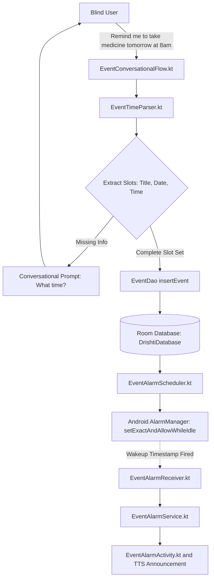

# Drishti AI — Voice Calendar & Event Scheduling

## 1. Overview & Objectives

Managing schedules, appointments, and medication reminders without visual sight requires a fluid, conversational interface. Drishti AI integrates an end-to-end voice-driven calendar management module that converts spoken instructions into persistent events, schedules exact device wakeup alarms, and recovers scheduled alarms after phone reboots.



---

## 2. Conversational Slot Filling & Parsing

### 2.1 Multi-Turn Conversational Flow (`EventConversationalFlow.kt`)
The conversational flow operates as a deterministic state machine:
1. **Initial Command:** User initiates event creation via voice: *"Add an appointment"*, *"Schedule a reminder"*, or directly with details: *"Doctor visit next Monday at 3pm"*.
2. **Entity Extraction:** `EventTimeParser` parses temporal expressions and extracts:
   * **Title / Description:** The core subject of the event.
   * **Target Date & Time:** Absolute epoch milliseconds.
   * **Reminder Cadence:** Default 15 minutes prior, or customized.
3. **Conversational Clarification:** If the user specifies an incomplete phrase (e.g., *"Remind me to call Mom"*), the assistant asks a targeted follow-up: *"On what date and time should I remind you?"*
4. **Auditory Confirmation:** Before persisting, the assistant reads back the details: *"Saved reminder: Call Mom, tomorrow at 5:00 PM."*

### 2.2 Natural Language Temporal Parsing (`EventTimeParser.kt`)
Supports flexible English, Hindi, and Marathi temporal expressions:
* **Relative offsets:** *"in 20 minutes"*, *"in 2 hours"*, *"आधे घंटे में"*.
* **Day-relative anchors:** *"tomorrow at 9am"*, *"tonight at 8pm"*, *"कल दोपहर 2 बजे"*, *"उद्या सकाळी १० वाजता"*.
* **Day of week:** *"this Friday at 4pm"*, *"next Tuesday morning"*.
* **AM/PM ambiguity resolution:** If hour is $\le 7$ without an AM/PM designator and afternoon context is implied, defaults sensibly to PM.

---

## 3. Local Persistence Layer (`EventDao.kt` & `EventEntities.kt`)

Events are stored locally in the encrypted Room SQLite database:

```kotlin
@Entity(tableName = "events")
data class EventEntity(
    @PrimaryKey(autoGenerate = true) val id: Long = 0,
    @ColumnInfo(name = "title") val title: String,
    @ColumnInfo(name = "description") val description: String? = null,
    @ColumnInfo(name = "event_time_epoch_ms") val eventTimeEpochMs: Long,
    @ColumnInfo(name = "reminder_offset_minutes") val reminderOffsetMinutes: Int = 15,
    @ColumnInfo(name = "is_alarm_active") val isAlarmActive: Boolean = true,
    @ColumnInfo(name = "is_completed") val isCompleted: Boolean = false,
    @ColumnInfo(name = "created_at_ms") val createdAtMs: Long = System.currentTimeMillis()
)
```

The `EventDao` provides standard reactive queries via `Flow<List<EventEntity>>`, enabling the Compose UI (`EventsScreen.kt`) to automatically reflect new, updated, or dismissed events in real time.

---

## 4. Exact Wakeup Alarms & Reboot Restoration

### 4.1 System Alarm Scheduling (`EventAlarmScheduler.kt`)
Standard Android timer notifications are often delayed by aggressive battery-saving modes (Doze mode). To ensure critical medication and mobility reminders execute on time, Drishti AI utilizes:
```kotlin
alarmManager.setExactAndAllowWhileIdle(
    AlarmManager.RTC_WAKEUP,
    triggerTimeEpochMs,
    pendingIntent
)
```

### 4.2 Full-Screen Alert Overlay (`EventAlarmActivity.kt`)
When the alarm fires:
* Android wakes the CPU and presents `EventAlarmActivity` over the lockscreen (`setShowWhenLocked(true)`, `setTurnScreenOn(true)`).
* The assistant plays an audible alert tone accompanied by continuous TTS reading of the event title.
* The screen displays massive, high-contrast touch zones:
  * **Top Half:** Dismiss Alarm (`#10B981` Green, accessible label: *"Dismiss Reminder"*).
  * **Bottom Half:** Snooze 10 Minutes (`#F59E0B` Amber, accessible label: *"Snooze Reminder"*).

### 4.3 Device Reboot Recovery (`EventRebootReceiver.kt`)
System `AlarmManager` schedules are wiped when an Android device powers off or restarts. Drishti AI overcomes this via a dedicated broadcast receiver:
```kotlin
class EventRebootReceiver : BroadcastReceiver() {
    override fun onReceive(context: Context, intent: Intent) {
        if (intent.action == Intent.ACTION_BOOT_COMPLETED) {
            val scope = CoroutineScope(Dispatchers.IO)
            scope.launch {
                val db = DrishtiDatabase.getInstance(context)
                val upcoming = db.eventDao().getUpcomingActiveEvents(System.currentTimeMillis())
                upcoming.forEach { event ->
                    EventAlarmScheduler.scheduleAlarm(context, event)
                }
            }
        }
    }
}
```
All pending reminders are transparently restored within seconds of boot completion.
