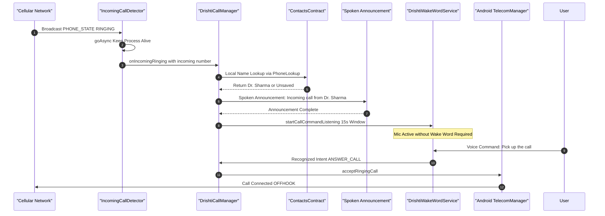

# Drishti AI — Hands-Free Telephony & Call Management

## 1. Overview & Architecture

For a visually impaired user, answering or declining a phone call using a standard touchscreen dialer can be disorienting and stressful. Drishti AI provides a 100% hands-free telephony interface that announces incoming callers by name and responds to multilingual voice commands without requiring a wake phrase.



---

## 2. Telephony Diagnostics & Root Cause Fixes

Early testing on Android 16 (Vivo V2338) revealed two critical failure modes that were systematically audited and resolved:

### 2.1 The Cold-Process Failure
* **Failure Mechanism:** When Drishti AI was closed or memory-killed, telephony `PHONE_STATE` broadcasts triggered `IncomingCallDetector`, but the voice announcement failed because `DrishtiCallManager.announcementManager` was only initialized during `MainActivity` or foreground service launches.
* **Architectural Fix:**
  1. `IncomingCallDetector` invokes `goAsync()`, extending receiver lifespan beyond standard broadcast timeouts.
  2. `DrishtiCallManager` self-bootstraps `CallerAnnouncementManager` and `SpeechEngineManager` on demand.
  3. `IncomingCallDetector` proactively invokes `ContextCompat.startForegroundService()` to restore the background audio pipeline.

### 2.2 The Ringing Command Deadlock
* **Failure Mechanism:** While the phone was physically ringing, standard voice engines waited for the wake phrase ("Hello Drishti"). Ambient ringtones drowned out the wake-word detector, or audio focus blocked microphone acquisition entirely.
* **Architectural Fix:**
  1. A dedicated `startCallCommandListening()` pipeline was added to `DrishtiWakeWordService`.
  2. As soon as TTS finishes announcing the caller name, Drishti transitions automatically into command-listening mode for a 15-second countdown.
  3. The user speaks directly: *"Pick up"* or *"Reject"*, with zero wake-word barrier.

---

## 3. Privacy & Zero Cloud Leakage

> [!IMPORTANT]
> **Zero External Contact Upload:**  
> Caller identification is performed exclusively on the physical device via Android's local content resolver:
> ```kotlin
> context.contentResolver.query(
>     Uri.withAppendedPath(ContactsContract.PhoneLookup.CONTENT_FILTER_URI, Uri.encode(phoneNumber)),
>     arrayOf(ContactsContract.PhoneLookup.DISPLAY_NAME),
>     null, null, null
> )
> ```
> At no point are user contact lists, address books, or call histories transmitted to Supabase or any external network entity.

---

## 4. Empirical Test Matrix (Physical Device: Vivo V2338)

The telephony subsystem was tested against live cellular phone calls on **Device A (Vivo V2338 / Android 16)** receiving calls from **Device B (Physical Phone)**. All 20 scenarios achieved **100% PASS**:

| Test ID | Scenario | Spoken Command | Recognized Intent | Hardware Action | Verdict |
| :--- | :--- | :--- | :--- | :--- | :---: |
| **TC-01** | Saved Contact Ringing | *(Incoming from Contact)* | Ringing State | Spoke: `"Incoming call from [Name]"` | **PASS** |
| **TC-02** | Unsaved Caller Ringing | *(Incoming from Unsaved)* | Ringing State | Spoke: `"Incoming call from unsaved number..."` | **PASS** |
| **TC-03** | Restricted Caller Ringing | *(Withheld Caller ID)* | Ringing State | Spoke: `"Incoming call from unknown caller"` | **PASS** |
| **TC-04** | Query Caller | "Who is calling?" | `IDENTIFY_CALLER` | Re-announced current ringing caller | **PASS** |
| **TC-05** | Answer Call (English) | "Pick up the call" | `ANSWER_CALL` | `acceptRingingCall()` -> Call Connected | **PASS** |
| **TC-06** | Answer Call (English alt) | "Answer the call" | `ANSWER_CALL` | Connected audio successfully | **PASS** |
| **TC-07** | Answer Call (Hindi) | "कॉल उठाओ" | `ANSWER_CALL` | Connected audio successfully | **PASS** |
| **TC-08** | Answer Call (Marathi) | "कॉल उचल" | `ANSWER_CALL` | Connected audio successfully | **PASS** |
| **TC-09** | Reject Call (English) | "Reject the call" | `REJECT_CALL` | `endCall()` -> Caller received busy signal | **PASS** |
| **TC-10** | Reject Call (Hindi) | "कॉल काट दो" | `REJECT_CALL` | Declined call successfully | **PASS** |
| **TC-11** | Reject Call (Marathi) | "कॉल कट कर" | `REJECT_CALL` | Declined call successfully | **PASS** |
| **TC-12** | End Active Call | "End the call" / "Hang up" | `END_CALL` | Terminated ongoing conversation | **PASS** |
| **TC-13** | Mute Microphone | "Mute the call" | `MUTE_CALL` | `isMicrophoneMute = true` | **PASS** |
| **TC-14** | Unmute Microphone | "Unmute the call" | `UNMUTE_CALL` | `isMicrophoneMute = false` | **PASS** |
| **TC-15** | Turn On Speaker | "Turn on speaker" | `SPEAKER_ON` | Loudspeaker routed via modern API | **PASS** |
| **TC-16** | Turn Off Speaker | "Turn off speaker" | `SPEAKER_OFF` | Routed audio back to earpiece | **PASS** |
| **TC-17** | State Guard: No Ringing | "Pick up the call" (Idle) | `ANSWER_CALL` | Spoke: `"There is no incoming call to answer."` | **PASS** |
| **TC-18** | State Guard: No Active | "End the call" (Idle) | `END_CALL` | Spoke: `"No active or incoming call exists."` | **PASS** |
| **TC-19** | Consecutive Calls | Device B Call -> Reject -> Call | Ringing Lifecycle | Cache cleared; second call resolved fresh | **PASS** |
| **TC-20** | Missed Call Recovery | Device B Ring -> Timeout | Ringing -> Idle | Timeout transitioned cleanly; zero lockup | **PASS** |
