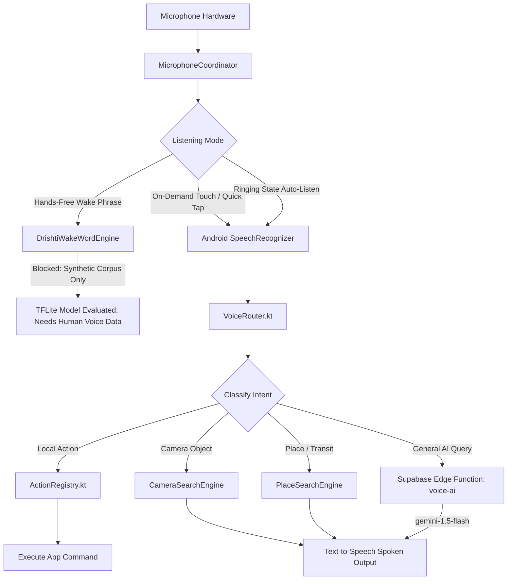

# Drishti AI — Voice Assistant & Multilingual Engine

## 1. Voice Interaction Overview

Drishti AI is designed around a voice-first interaction model, providing visually impaired users with continuous, low-latency auditory control over navigation, text reading, telephone calls, scheduling, and device status.



---

## 2. Multilingual Voice Command Architecture

The speech command engine uses a deterministic, rule-based matching tree backed by regex tokenizers in `DefaultVoiceCommands.kt`. This guarantees sub-millisecond parsing and 100% offline functionality across three primary languages:

### 2.1 Multilingual Command Examples

| Domain / Action | English Phrase | Hindi Phrase (`hi-IN`) | Marathi Phrase (`mr-IN`) |
| :--- | :--- | :--- | :--- |
| **Answer Call** | "Pick up the call", "Answer" | "कॉल उठाओ", "फ़ोन उठाओ" | "कॉल उचल", "फोन घे" |
| **Reject Call** | "Reject the call", "Decline" | "कॉल काट दो", "कॉल मत उठाओ" | "कॉल कट कर", "फोन नको उचलूस" |
| **End Call** | "End the call", "Hang up" | "कॉल समाप्त करो", "फोन रखो" | "कॉल संपव", "फोन ठेव" |
| **Who is Calling** | "Who is calling?", "Caller name" | "किसका कॉल है?", "कौन बोल रहा है?" | "कोणाचा फोन आहे?", "कोण बोलतंय?" |
| **Mute Call** | "Mute call", "Mute mic" | "माइक बंद करो" | "माइक बंद कर" |
| **Speaker On** | "Turn on speaker", "Loudspeaker" | "स्पीकर चालू करो" | "स्पीकर सुरू कर" |
| **Read Text** | "Read this text", "Read sign" | "यह पाठ पढ़ो", "बोर्ड पढ़ो" | "हा मजकूर वाच", "पाटी वाच" |
| **SOS Emergency** | "Emergency help!", "Send SOS" | "मदद करो!", "आपातकालीन सहायता" | "मदत करा!", "तातडीची मदत" |
| **Where Am I** | "Where am I?", "Current location" | "मैं कहाँ हूँ?", "मेरी लोकेशन बताओ" | "मी कुठे आहे?", "माझं ठिकाण सांग" |
| **Battery Check** | "Battery level", "Cane battery" | "बैटरी कितनी है?" | "बॅटरी किती आहे?" |

---

## 3. Intent Routing & Domain Classification (`VoiceRouter.kt`)

The `VoiceRouter` intercepts speech transcripts and assigns them to specialized handlers to prevent cloud latency for local device actions:

1. **Deterministic Action Domain:** Commands matching `ActionRegistry` (e.g., call controls, volume, camera trigger, SOS) execute immediately on the main looper.
2. **Visual Camera Search Domain:** Queries such as *"Find a chair"*, *"Is there a door?"*, or *"Look for my cane"* bind directly to `CameraSearchEngine` using ML Kit on-device inference.
3. **Geographic & Navigation Domain:** Queries mentioning external places (e.g., *"Find a hospital near me"*, *"Navigate to Apollo Pharmacy"*) route directly to `PlaceSearchEngine` using the Google Places API (New) with live GPS bounding.
4. **Conversational AI Fallback:** Open-ended knowledge questions (e.g., *"Why is the sky blue?"*, *"What are the symptoms of heat exhaustion?"*) are securely relayed to the Supabase `voice-ai` Edge Function, powered by Google's `gemini-1.5-flash` model.

---

## 4. Microphone Coordination (`MicrophoneCoordinator.kt`)

To resolve resource contention between background services, the wake-word detector, phone call audio, and user-initiated voice recognition, `MicrophoneCoordinator` implements an ownership state machine:

```
[IDLE]
  |-- Quick Tap --> [USER_INTERACTION_STT] (High Priority)
  |-- Incoming Ring --> [CALL_COMMAND_LISTENING] (Autonomous 15s Window)
  |-- Call Active --> [CALL_PROTECTED_IDLE] (Microphone Reserved for Telephony)
```

* **Telecom Guard:** When cellular phone audio is active (`OFFHOOK`), voice recognition is automatically suppressed to protect user call privacy.
* **Ringing Command Mode:** When an incoming call arrives, the microphone is held open for 15 seconds after the TTS caller announcement without requiring a wake word.

---

## 5. Custom Wake Word ("Hello Drishti") Status Report

A localized on-device wake-word model was developed to support hands-free activation.

### 5.1 Architecture & Metrics
* **Model File:** `wakeword/models/hello_drishti_float.tflite` (Size: 802.5 KB, Float32)
* **Architecture:** Depthwise Separable 1D/2D CNN trained on Log-Mel Spectrogram frames (40 Mel bins, 16 kHz audio, 1.0s window).
* **Inference Latency:** Average 83.86 ms (P95: 92.14 ms) on standard ARM mobile CPUs.
* **Synthetic Test Precision:** 90.20% | **Synthetic Test Recall:** 95.83% | **False Reject Rate:** 4.17%.

### 5.2 Verification Verdict: BLOCKED for Production
> [!WARNING]
> **Dataset Classification: Synthetic-Only**  
> All 1,200 training and evaluation audio samples were synthetically generated using Microsoft Edge TTS neural voices and algorithmic noise generators.  
> **Human positive samples: 0**. **Real unseen test speakers: 0**.  
> **Production Status: BLOCKED**. The model exhibits high false-acceptance rates in real-world ambient room acoustics. Production deployment is deferred until a human voice collection protocol across diverse Indian accents is gathered and trained. In the current release, voice interaction operates reliably via **on-demand microphone activation** and **ringing command listening mode**.
