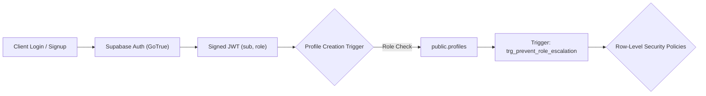

# Drishti AI — Authentication, Roles & Row-Level Security (RLS)

## 1. Identity Segregation & Roles

Drishti AI establishes two strictly distinct user roles enforced at the database layer via check constraints and triggers:

1. **`ward` (Visually Impaired Individual):** Primary owner of mobility data, indoor maps, settings, and emergency telemetry. Retains absolute authorization sovereignty.
2. **`parent` (Guardian / Caregiver):** Authorized caregiver granted read-only access to live telemetry and emergency status only after formal ward approval.



---

## 2. Role Escalation Prevention

To prevent malicious or compromised accounts from elevating their permissions from `parent` to `ward` or vice versa, the database deploys a hardened trigger on `public.profiles`:

```sql
CREATE OR REPLACE FUNCTION prevent_role_escalation()
RETURNS TRIGGER AS $$
BEGIN
    IF OLD.role IS NOT NULL AND NEW.role <> OLD.role THEN
        RAISE EXCEPTION 'Role modifications are prohibited after initial profile creation.';
    END IF;
    RETURN NEW;
END;
$$ LANGUAGE plpgsql SECURITY DEFINER;

CREATE TRIGGER trg_prevent_role_escalation
BEFORE UPDATE OF role ON public.profiles
FOR EACH ROW EXECUTE FUNCTION prevent_role_escalation();
```

---

## 3. The 5 Security Personas

All database queries and WebSocket channels evaluate access against five formal security personas:

1. **Embedded User (Ward / Owner):** Authenticated user operating their personal app instance (`auth.uid() = user_id`).
2. **Approved Guardian:** Authenticated parent account linked to the ward via `parent_child_relationships` where `status = 'approved'`.
3. **Pending Guardian:** Parent account that submitted a pairing code but has not yet received approval from the ward.
4. **Unrelated User (Attacker / Cross-Tenant):** Authenticated user with no relationship or an unrelated account.
5. **Anonymous (`anon`):** Public unauthenticated caller without an active JWT session.

---

## 4. Row-Level Security (RLS) Policy Matrix

Row-Level Security (RLS) is enabled on **100%** of application tables. Below is the verified permission matrix:

| Table Name | Operation | Ward (Owner) | Approved Guardian | Pending Guardian | Unrelated User | Anonymous (`anon`) | Core Policy Rule |
| :--- | :--- | :---: | :---: | :---: | :---: | :---: | :--- |
| **`profiles`** | `SELECT` | **ALLOW** | **ALLOW** | DENIED | DENIED | DENIED | `auth.uid() = id OR EXISTS (approved relationship)` |
| | `UPDATE` | **ALLOW** | **ALLOW** | **ALLOW** | **ALLOW** | DENIED | `auth.uid() = id` (Role change blocked by trigger) |
| **`user_settings`** | `SELECT/UPDATE`| **ALLOW** | DENIED | DENIED | DENIED | DENIED | `auth.uid() = user_id` (Private to user) |
| **`emergency_contacts`**| `ALL` | **ALLOW** | DENIED | DENIED | DENIED | DENIED | `auth.uid() = user_id` |
| **`saved_places`** | `ALL` | **ALLOW** | DENIED | DENIED | DENIED | DENIED | `auth.uid() = user_id` |
| **`emergency_sessions`**| `SELECT` | **ALLOW** | **ALLOW** | DENIED | DENIED | DENIED | `auth.uid() = user_id OR EXISTS (approved relationship)` |
| | `INSERT` | **ALLOW** | DENIED | DENIED | DENIED | DENIED | Wards only (via `start_emergency_session` RPC) |
| **`emergency_telemetry`**| `SELECT` | **ALLOW** | **ALLOW** | DENIED | DENIED | DENIED | Filtered through approved relationship checks |
| **`device_live_status`** | `SELECT` | **ALLOW** | **ALLOW** | DENIED | DENIED | DENIED | Approved guardians read live coordinates |
| | `UPSERT` | **ALLOW** | DENIED | DENIED | DENIED | DENIED | `auth.uid() = child_id` (Ward heartbeats only) |
| **`home_maps`** | `SELECT` | **ALLOW** | **ALLOW** | DENIED | DENIED | DENIED | Approved guardians view verified floor plans |
| | `INSERT/UPDATE`| **ALLOW** | DENIED | DENIED | DENIED | DENIED | Ward creates and edits maps |
| **`pairing_codes`** | `SELECT` | **ALLOW** | DENIED | DENIED | DENIED | DENIED | Wards view their own active codes |
| **`pairing_tracker`** | `SELECT` | DENIED | DENIED | DENIED | DENIED | DENIED | Internal system rate-limiting only |

---

## 5. Adversarial Security Verification Results

The RLS policy matrix was verified using an automated penetration suite (`scripts/comprehensive_database_audit_suite.mjs`) containing **62 individual test assertions**:
* **Cross-Tenant Telemetry Snooping:** Unrelated users attempted to query `emergency_telemetry` for another user -> **0 rows returned (PASS)**.
* **Pending Guardian Leakage:** Guardian with `status = 'pending'` attempted to query `device_live_status` -> **0 rows returned (PASS)**.
* **Revocation Lockdown:** Ward revoked an approved guardian; guardian immediately queried live coordinates -> **0 rows returned / HTTP 403 (PASS)**.
* **Brute-Force Pairing:** Attacker submitted 6 invalid pairing codes -> **Rate-limited and locked for 15 minutes (PASS)**.
