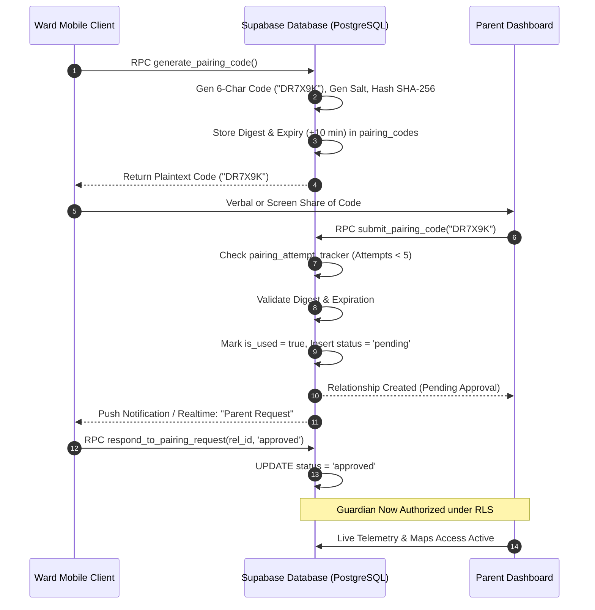

# Drishti AI — Cryptographic Guardian Pairing Architecture

## 1. Pairing Objectives & Threat Model

Caregiver monitoring must never compromise user autonomy or allow covert tracking. Drishti AI enforces a cryptographic, multi-step pairing ceremony designed against specific threat vectors:

1. **Brute-Force Enumeration:** Attackers must not be able to guess 6-character pairing codes via automated scripts.
2. **Database Leakage:** Compromise of database read backups must not reveal plaintext active pairing codes.
3. **Surreptitious Linking:** Parents cannot unilaterally link an account; the ward must explicitly authorize every connection.
4. **Permanent Authorization Traps:** The ward must be able to revoke a guardian at any time, instantly cutting off all telemetry access.



---

## 2. Cryptographic Digest & Salt Generation

Pairing codes are generated exclusively on the database server via the `generate_pairing_code()` stored procedure:

```sql
CREATE OR REPLACE FUNCTION generate_pairing_code()
RETURNS TEXT AS $$
DECLARE
    v_raw_code TEXT;
    v_salt TEXT;
    v_digest TEXT;
    v_user_role TEXT;
BEGIN
    -- Verify caller is authenticated ward
    SELECT role INTO v_user_role FROM public.profiles WHERE id = auth.uid();
    IF v_user_role <> 'ward' THEN
        RAISE EXCEPTION 'Only visually impaired wards can generate pairing codes.';
    END IF;

    -- Generate random 6-character alphanumeric uppercase code
    v_raw_code := upper(substr(md5(random()::text), 1, 6));
    v_salt := gen_random_uuid()::text;
    
    -- Compute cryptographic SHA-256 hash
    v_digest := encode(digest(v_raw_code || v_salt, 'sha256'), 'hex');

    -- Deactivate previous codes and insert new active digest
    UPDATE public.pairing_codes SET is_used = true WHERE child_id = auth.uid() AND is_used = false;
    
    INSERT INTO public.pairing_codes (child_id, code_digest, salt, expires_at, is_used)
    VALUES (auth.uid(), v_digest, v_salt, now() + interval '10 minutes', false);

    RETURN v_raw_code;
END;
$$ LANGUAGE plpgsql SECURITY DEFINER;
```

---

## 3. Rate Limiting & Brute-Force Lockout (`pairing_attempt_tracker`)

To neutralize dictionary and brute-force attacks on 6-character codes, the `submit_pairing_code()` RPC tracks consecutive failures:

* **Threshold:** A maximum of **5 failed attempts** are permitted per parent account within a rolling 1-hour window.
* **Lockout:** Upon the 5th failure, `locked_until` is set to `now() + interval '15 minutes'`.
* **Zero Enumeration Leakage:** Failed attempts return a generic error message (*"Invalid or expired pairing code"*), preventing timing side-channel attacks.

---

## 4. Ward Revocation Sovereignty

The core ethical foundation of Drishti AI is that **the ward always holds sovereignty over their location data**:

1. At any point, the ward can view active guardians in their app under **Settings &rarr; Linked Guardians**.
2. With a single voice command (*"Revoke guardian access"*) or accessible button tap, the ward calls `respond_to_pairing_request(relationship_id, 'revoked')`.
3. The database trigger updates `status = 'revoked'`.
4. **Immediate RLS Lockdown:** Because all parent select policies evaluate `EXISTS (SELECT 1 FROM parent_child_relationships WHERE parent_id = auth.uid() AND child_id = profiles.id AND status = 'approved')`, the guardian’s next database read or Realtime ping instantly returns **0 rows**.
5. Live GPS markers and cane telemetry disappear immediately from the parent dashboard.
