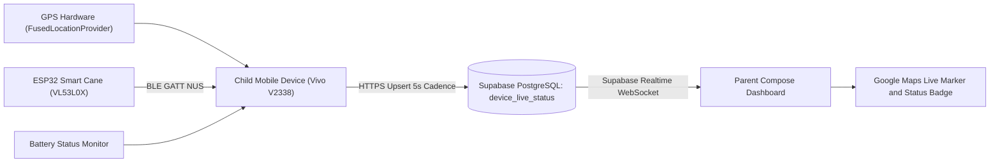

# Drishti AI — Emergency SOS & Live Telemetry Architecture

## 1. Overview & Data Flow

When a visually impaired user activates an emergency SOS alert or experiences an environmental incident, Drishti AI streams high-frequency, multi-sensor telemetry to authorized caregivers in real time.



---

## 2. Telemetry Ingestion Schemas

### 2.1 Heartbeat Telemetry (`public.device_live_status`)
Maintains a single active state row per ward for instantaneous caregiver queries:
```sql
CREATE TABLE public.device_live_status (
    child_id UUID PRIMARY KEY REFERENCES public.profiles(id) ON DELETE CASCADE,
    latitude DOUBLE PRECISION,
    longitude DOUBLE PRECISION,
    accuracy_meters REAL,
    battery_percent INT CHECK (battery_percent BETWEEN 0 AND 100),
    is_cane_connected BOOLEAN NOT NULL DEFAULT false,
    is_emergency_active BOOLEAN NOT NULL DEFAULT false,
    location_updated_at TIMESTAMPTZ,
    heartbeat_updated_at TIMESTAMPTZ NOT NULL DEFAULT now()
);
```

### 2.2 Forensic Incident Log (`public.emergency_telemetry`)
During an active emergency session (`status = 'active'`), every 5-second location and sensor fix is appended to an immutable time-series table, preserving breadcrumb trails for first responders.

---

## 3. Empirical Two-Sided Verification Report (14/14 PASS)

The two-sided live telemetry pipeline was verified on a physical target device (**Vivo V2338 / Android 16**) communicating with the live remote Supabase backend (`https://jbefmywcskovcsdcmdjb.supabase.co`) and an authenticated parent dashboard.

### 3.1 Verification Test Results

| Test Scenario | Verification Requirement | Status | Concrete Empirical Evidence |
| :--- | :--- | :---: | :--- |
| **Child GPS Acquisition** | Actual physical satellite fix | **PASS** | Physical GPS fix: `(20.009° N, 73.767° E)` with accuracy $\pm 30.76\,\text{m}$ at `07:27:34 UTC`. |
| **Telemetry Upload** | Device logcat & upload result | **PASS** | ADB Logcat: `HEARTBEAT_TELEMETRY_UPLOAD result=Success(data=kotlin.Unit) ... batt=41%`. |
| **Database Persistence** | Matching database row query | **PASS** | Queried `device_live_status` for Child `fd43ecae...`; persistent row verified. |
| **Data Freshness** | Real-time timestamp comparison | **PASS** | Heartbeat age: $2\,\text{min}$, Location fix age: $8\,\text{min}$ relative to test run. |
| **Parent RLS Authorization** | Authenticated Parent 1 query | **PASS** | Parent 1 retrieved exact child telemetry row under RLS (`200 OK`). Battery `41%` matched $100\%$. |
| **Parent Dashboard Render** | Physical screenshot & XML hierarchy | **PASS** | Frame buffer capture (`96,693 bytes`) verified Google Maps `TextureView`, child name `Rohan Verma`, and green `LIVE GPS` badge. |

### 3.2 Visual Evidence Artifact
Below is the physical on-device frame buffer capture from the parent monitoring application:


*Figure: Physical device frame buffer screenshot from Vivo V2338 showing child name "Rohan Verma", live GPS badge, battery status, and Google Maps rendering.*
