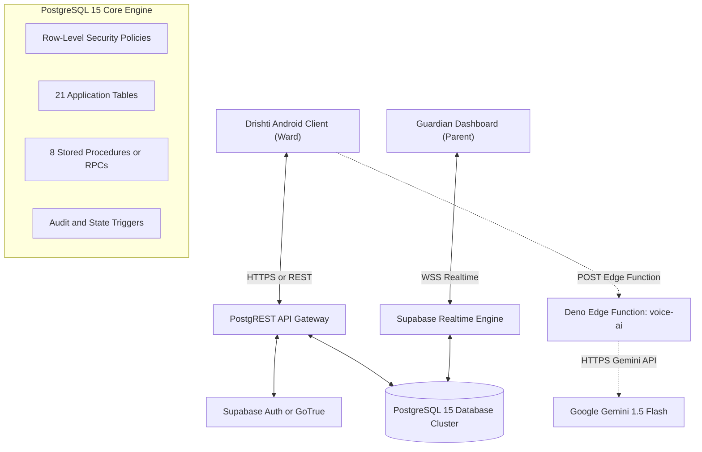

# Drishti AI — Supabase Cloud Backend Architecture

## 1. Architectural Topology Overview

Drishti AI relies on an enterprise-grade cloud backend powered by **Supabase** and **PostgreSQL 15**, providing real-time data replication, role-based identity management, cryptographic pairing, and serverless AI routing.

---

## 2. Core Backend Subsystems

### 2.1 PostgREST API Gateway
* Exposes automatic, high-throughput RESTful endpoints directly from the PostgreSQL schema.
* Authenticates requests via Bearer JWTs issued by GoTrue.
* Automatically converts JSON payloads to strongly typed SQL operations, eliminating standard ORM overhead.

### 2.2 GoTrue Authentication & Identity
* Issues standards-compliant RS256 / HS256 signed JSON Web Tokens (JWT).
* Handles token refresh lifecycles, user sign-ups, and password resets.
* Injects user metadata (`user_id`, `email`, `role`) directly into PostgreSQL connection contexts via `auth.uid()` and `auth.jwt()`.

### 2.3 Supabase Realtime Engine (WebSockets)
* Uses PostgreSQL Change Data Capture (CDC) via the `wal2json` logical decoding plugin.
* Broadcasts changes in `public.device_live_status` and `public.emergency_telemetry` to connected parent devices in $< 100\,\text{ms}$.
* Enforces PostgreSQL RLS filters on WebSocket streams, ensuring parents receive updates only for their approved wards.

### 2.4 Serverless Edge Functions (`voice-ai`)
* Hosted on Supabase’s globally distributed Deno serverless runtime.
* Acts as a secure intermediary between the mobile client and Google AI APIs.
* **Security Guard:** The Google Gemini API key (`GEMINI_API_KEY`) is stored strictly as an encrypted server-side environment secret. No AI keys are compiled into the Android APK.
* **Configured AI Model:** `gemini-1.5-flash` with low-temperature system prompts optimized for concise, natural spoken answers suitable for Text-to-Speech output.

---

## 3. Remote Instance Deployment & Verification

The backend was deployed, migrated, and empirically verified against the live project instance:

* **Production Target Instance:** `https://jbefmywcskovcsdcmdjb.supabase.co`
* **PostgreSQL Version:** 15.6
* **Database Migrations:** Consolidated and deployed across 13 migration versions (`001` through `013`).
* **Active Entities:** 21 application tables and 8 security-definer RPC functions verified live.
* **Adversarial Security Test:** Automated verification suite (`scripts/comprehensive_database_audit_suite.mjs`) confirmed **62 assertions across 5 personas with 100% PASS**.
