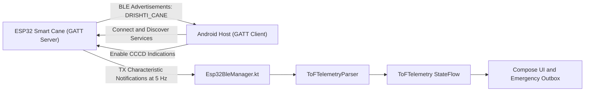

# Drishti AI Smart Cane — BLE Telemetry & Protocol Specification

## 1. Bluetooth Low Energy Architecture

The Drishti AI Smart Cane communicates wirelessly with the Android host application using the industry-standard **Nordic Semiconductor UART Service (NUS)** over Bluetooth Low Energy (BLE 4.2 / 5.0).



---

## 2. GATT Service & Characteristic UUIDs

The smart cane firmware exposes the standard 128-bit Nordic UART Service:

| GATT Entity | 128-Bit UUID | Properties | Description |
| :--- | :--- | :--- | :--- |
| **Primary Service (NUS)** | `6E400001-B5A3-F393-E0A9-E50E24DCCA9E` | Primary | Drishti Cane Telemetry Service |
| **RX Characteristic** | `6E400002-B5A3-F393-E0A9-E50E24DCCA9E` | `WRITE`, `WRITE_NO_RESP` | Commands sent from Phone to Cane (e.g., config, calibrate) |
| **TX Characteristic** | `6E400003-B5A3-F393-E0A9-E50E24DCCA9E` | `NOTIFY`, `READ` | Telemetry streamed continuously from Cane to Phone |
| **Client Char Config (CCCD)**| `00002902-0000-1000-8000-00805F9B34FB` | `READ`, `WRITE` | Standard descriptor written to enable notifications |

---

## 3. Telemetry Payload Format

The ESP32 transmits telemetry packets over the TX characteristic at a steady $5\,\text{Hz}$ rate ($200\,\text{ms}$ interval) or immediately upon distance zone changes.

### 3.1 Compact Binary Packet Format (Default — Low Energy)
To minimize airtime and power draw, telemetry is encoded in a 6-byte binary struct:

```text
Byte 0: Header (0xAA)
Byte 1: Distance MSB (uint16_t, in millimeters)
Byte 2: Distance LSB
Byte 3: Battery Percentage (uint8_t, 0 - 100)
Byte 4: Zone State (uint8_t: 0=Safe, 1=Caution, 2=Danger)
Byte 5: Checksum XOR (Byte 0 ^ Byte 1 ^ ... ^ Byte 4)
```

### 3.2 Human-Readable JSON Telemetry Format (Diagnostic Mode)
When connected in diagnostic mode or during USB serial debugging, the cane transmits formatted JSON strings:
```json
{
  "device": "DrishtiCane_v4",
  "tof_mm": 740,
  "zone": "CAUTION",
  "batt_pct": 84,
  "vibe_duty": 45,
  "uptime_s": 1420
}
```

---

## 4. Android Host Implementation (`Esp32BleManager.kt`)

The Android application manages BLE communication via a lifecycle-aware manager:

### 4.1 Auto-Discovery & Filtering
* Scans exclusively for BLE advertisements containing the service UUID `6E400001-B5A3-F393-E0A9-E50E24DCCA9E` or device names starting with `"DRISHTI"`.
* Uses Android 12+ modern permissions (`BLUETOOTH_SCAN`, `BLUETOOTH_CONNECT`) with location-fallback flags.

### 4.2 Auto-Reconnection & Backoff
If the user steps away from their cane or RF interference drops the link:
1. `BluetoothGattCallback.onConnectionStateChange()` catches `STATE_DISCONNECTED`.
2. Emits `ConnectionState.RECONNECTING` to the UI, triggering a gentle audio announcement: *"Cane disconnected, attempting to reconnect."*
3. Initiates exponential backoff scanning ($1\,\text{s}, 2\,\text{s}, 4\,\text{s}, 8\,\text{s}$, capped at $15\,\text{s}$).
4. Upon re-establishing the GATT connection, automatically renegotiates MTU ($512$ bytes) and re-enables TX notifications without user intervention.
