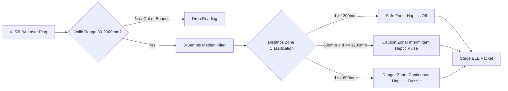

# Drishti AI — VL53L0X Time-of-Flight Lidar & ESP32 Integration

## 1. Time-of-Flight Sensing Principles

Traditional assistive canes utilizing ultrasonic ping sensors (e.g., HC-SR04) suffer from severe practical limitations:
1. **Acoustic Absorption:** Soft clothing (wool coats, winter jackets) absorbs sound waves, causing ultrasonic sensors to report clear paths when a person is directly ahead.
2. **Specular Reflection:** Angled glass doors or smooth walls deflect acoustic pings away from the receiver, creating false negatives.
3. **Beam Spread:** Broad $15^\circ$ cones create false positives from floors or ground clutter.

Drishti AI replaces ultrasound with the **STMicroelectronics VL53L0X Time-of-Flight (ToF)** sensor:
* **Infrared VCSEL Emitter:** Emits invisible $940\,\text{nm}$ laser photons.
* **SPAD Array Receiver:** Single Photon Avalanche Diode array measures the precise round-trip flight time of light photons:
  $$d = \frac{c \cdot \Delta t}{2}$$
* **Narrow Field of View:** $25^\circ$ conical beam concentrates on head and torso hazards without triggering false alarms from ground curbs.
* **Surface Invariance:** Accurate across surface reflectivity, color, and textile composition.

---

## 2. Hardware Interface & I2C Bus Configuration

The VL53L0X interfaces with the ESP32 via standard I2C at $400\,\text{kHz}$ Fast Mode:

| VL53L0X Pin | ESP32 Pin Assignment | Function Description | Notes |
| :--- | :--- | :--- | :--- |
| **VCC** | `3.3V` Rail | Regulated power supply | Must not exceed $3.6\,\text{V}$ |
| **GND** | `GND` Rail | Common system ground | Low-impedance ground plane |
| **SCL** | `GPIO 14` (ESP32-CAM) / `GPIO 22` | I2C Serial Clock line | $4.7\,\text{k}\Omega$ pullup to $3.3\,\text{V}$ |
| **SDA** | `GPIO 15` (ESP32-CAM) / `GPIO 21` | I2C Serial Data line | $4.7\,\text{k}\Omega$ pullup to $3.3\,\text{V}$ |
| **XSHUT** | `GPIO 13` / Direct 3.3V | Hardware shutdown / reset | Pulled high for normal operation |
| **GPIO1** | Floating / NC | Programmable interrupt out | Optional hardware threshold interrupt |

---

## 3. Firmware Sampling & Signal Processing Pipeline

The sensor is sampled deterministically at $10\,\text{Hz}$ ($100\,\text{ms}$ interval) on Core 1 of the ESP32.



### 3.1 Outlier Rejection via Median Filtering
To eliminate optical multipath glitches and sunlight scintillation, firmware maintains a 3-sample sliding buffer:
```cpp
uint16_t sample_buffer[3];
uint16_t get_filtered_distance(uint16_t new_sample) {
    sample_buffer[0] = sample_buffer[1];
    sample_buffer[1] = sample_buffer[2];
    sample_buffer[2] = new_sample;
    
    uint16_t a = sample_buffer[0], b = sample_buffer[1], c = sample_buffer[2];
    // Median of 3 elements
    if ((a <= b && b <= c) || (c <= b && b <= a)) return b;
    if ((b <= a && a <= c) || (c <= a && a <= b)) return a;
    return c;
}
```

---

## 4. Distance Zone Thresholds & Autonomous Actuation

Firmware continuously evaluates the filtered distance against three predefined physical safety zones:

| Distance Zone | Spatial Range | Haptic Motor State (Handle) | Piezo Buzzer State | Visual / Telemetry Code |
| :--- | :--- | :--- | :--- | :---: |
| **Safe Zone** | $> 1200\,\text{mm}$ ($> 1.2\,\text{m}$) | **OFF** ($0\%$ PWM) | **Silent** | `ZONE_CLEAR` |
| **Caution Zone** | $600\,\text{mm}$ to $1200\,\text{mm}$ | **Pulsed PWM:** Frequency increases linearly ($2\,\text{Hz}$ to $8\,\text{Hz}$) as distance decreases | **Silent** (Tactile only) | `ZONE_CAUTION` |
| **Danger Zone** | $\le 600\,\text{mm}$ ($\le 0.6\,\text{m}$) | **Continuous Active:** $100\%$ duty cycle ($3.0\,\text{V}$) | **Audible Beep:** $2.4\,\text{kHz}$ tone at $10\,\text{Hz}$ cadence | `ZONE_DANGER` |

Because actuation logic resides directly within the ESP32 firmware task, latency between obstacle detection and handle vibration is consistently $< 50\,\text{ms}$.
