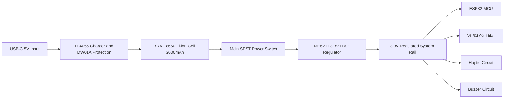

# Drishti AI Smart Cane — Wiring Schematics & Power Management

## 1. Complete Schematic Pinout Table

The smart cane uses an optimized pin mapping that avoids conflicts with onboard camera pins, flash memory, and bootstrapping GPIOs:

| ESP32-CAM Pin | Target Subsystem | Peripheral Connection | Function / Electrical Notes |
| :--- | :--- | :--- | :--- |
| **GPIO 14** | VL53L0X ToF Lidar | `SCL` (Clock) | I2C Serial Clock ($400\,\text{kHz}$); $4.7\,\text{k}\Omega$ pullup to $3.3\,\text{V}$ |
| **GPIO 15** | VL53L0X ToF Lidar | `SDA` (Data) | I2C Serial Data; $4.7\,\text{k}\Omega$ pullup to $3.3\,\text{V}$ |
| **GPIO 12** | Haptic Vibration Motor | Gate of 2N7000 N-MOSFET | PWM driver ($10\,\text{k}\Omega$ pulldown, flyback diode across motor) |
| **GPIO 13** | Acoustic Buzzer | Base of SS8050 NPN Transistor | Digital out; $1\,\text{k}\Omega$ base resistor, buzzer to $3.3\,\text{V}$ |
| **GPIO 33** | Diagnostic LED | Built-in Red LED (Inverted) | Status indicator: solid on boot, pulses on BLE activity |
| **GPIO 34 / 36** | Battery ADC Voltage | Center tap of Voltage Divider | Dual $100\,\text{k}\Omega$ divider ($2:1$ scale) to read $3.0\text{--}4.2\,\text{V}$ battery |
| **3V3** | System Power Rail | Sensor VCC, Pullups, LDO Out | Clean $3.3\,\text{V}$ regulated DC rail |
| **GND** | System Ground | Battery Negative, Sensor GNDs | Common star ground topology |

---

## 2. Actuator Drive Circuits

### 2.1 Vibration Motor Drive (Inductive Protection)
DC coin motors generate high inductive voltage spikes upon cutoff that can destroy MCU GPIOs. Drishti AI utilizes a protected low-side MOSFET switch:

```text
               +3.3V Rail
                   |
                   +-------+
                   |       |
                 [Motor] [1N4148 Diode] (Cathode to +3.3V)
                   |       |
                   +-------+
                   |
                 Drain
GPIO 12 ---[100R]--- Gate  (2N7000 N-Channel MOSFET)
                   |
              [10k Pulldown]
                   |
                 Source
                   |
                  GND
```

### 2.2 Battery Voltage Sensing Divider
To prevent exceeding the ESP32’s maximum ADC input voltage ($3.3\,\text{V}$), the battery rail ($3.0\,\text{V}$ to $4.2\,\text{V}$) passes through an equal-resistor divider:
$$V_{\text{ADC}} = V_{\text{batt}} \cdot \left(\frac{100\,\text{k}\Omega}{100\,\text{k}\Omega + 100\,\text{k}\Omega}\right) = \frac{V_{\text{batt}}}{2}$$
When fully charged ($4.2\,\text{V}$), $V_{\text{ADC}} = 2.1\,\text{V}$, well within safe linear ADC conversion range.

---

## 3. Power Supply Architecture & Battery Budget



### 3.1 Power States & Current Consumption

| Operating State | Active Components | Average Current ($I_{\text{avg}}$) | Est. Battery Life ($2600\,\text{mAh}$) |
| :--- | :--- | :---: | :---: |
| **Deep Sleep Mode** | RTC Timer only | $15\,\mu\text{A}$ | $> 12\,\text{months}$ |
| **Autonomous Sensing (BLE Idle)** | ESP32 Core 1 @ 80 MHz, VL53L0X 10 Hz | $45\,\text{mA}$ | $\approx 46\,\text{hours}$ |
| **Active Paired Mode (BLE Streaming)** | ESP32 Core 1 @ 160 MHz, BLE GATT Tx @ 5 Hz | $95\,\text{mA}$ | $\approx 22\,\text{hours}$ |
| **Collision Burst (Motor + Buzzer)** | Motor active (80 mA) + Buzzer (30 mA) + BLE | $205\,\text{mA}$ | $\approx 10\,\text{hours}$ (Intermittent) |
| **Full Video Stream (Wi-Fi MJPEG)** | OV2640 + Wi-Fi 802.11n Tx + VL53L0X | $310\,\text{mA}$ | $\approx 6.7\,\text{hours}$ continuous |

---

## 4. Mechanical Enclosure & Environmental Protection

1. **Material:** 3D printed using PETG or ABS for high mechanical impact tolerance and temperature resistance up to $75^\circ\text{C}$.
2. **Mounting:** Clamps securely onto standard $19\,\text{mm}$ to $22\,\text{mm}$ aluminum or carbon-fiber cane shafts with dual M3 stainless fasteners.
3. **Ingress Protection:** Internal rubber gaskets surround the USB-C charging port, with an optical window slot recessing the VL53L0X sensor to prevent scratching and ambient rain ingress.
