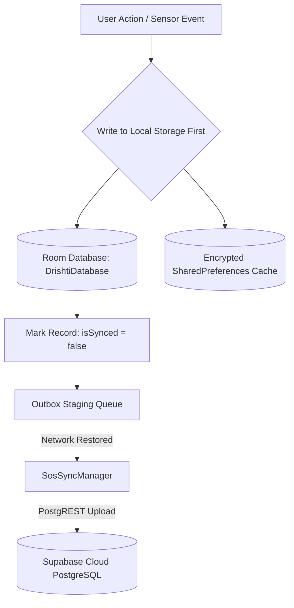

# Drishti AI — Offline-First Architecture & Local Storage

## 1. Local Storage Objectives & Architecture

Cellular coverage is inherently unpredictable in subways, basements, rural transit stops, and dense urban corridors. Assistive technology that fails when disconnected from the internet is dangerous.

Drishti AI is built upon an **offline-first local persistence architecture**:
* All core actions (scheduling events, recording emergency logs, caching settings, sensing obstacles) execute against **local encrypted storage first**.
* Remote cloud synchronization operates asynchronously in the background.

---

## 2. Room Relational Database (`DrishtiDatabase.kt`)

The primary relational datastore on the device is built using **Android Jetpack Room v2.6+**:

### 2.1 Database Entities & Schemas

| Entity Class | Primary Key | Key Fields | Purpose |
| :--- | :--- | :--- | :--- |
| **`EventEntity`** | `id Long (Auto)` | `title`, `eventTimeEpochMs`, `isAlarmActive`, `reminderOffsetMinutes` | Local calendar reminders and alarms |
| **`SosSessionEntity`** | `localId Long (Auto)` | `remoteSessionId UUID?`, `triggerType`, `lastLatitude`, `lastLongitude`, `isSynced` | Emergency SOS outbox sessions |
| **`SosTelemetryEntity`** | `localId Long (Auto)` | `localSessionId Long`, `latitude`, `longitude`, `tofDistanceMm`, `isSynced` | High-frequency emergency breadcrumbs |
| **`SosDeliveryReceiptEntity`** | `id Long (Auto)` | `sessionId`, `channel (SMS/API)`, `recipient`, `deliveryStatus`, `timestamp` | Audit receipts for emergency alerts |
| **`SosGuardianDeviceEntity`** | `guardianId UUID` | `guardianName`, `deviceToken`, `lastKnownActiveTime` | Cached authorized guardian metadata |
| **`SosGuardianReceivedAlertDao`**| `alertId UUID` | `childId`, `severity`, `receivedTimestamp`, `isAcknowledged` | Parent-side cached emergency alerts |

---

## 3. Sandboxed Settings Cache (`drishti_settings`)

User preferences are managed through a dual-layer caching strategy:
1. **Local Sandboxed SharedPreferences:** Stored in app-private XML storage (`/data/user/0/com.example.drishti/shared_prefs/drishti_settings.xml`).
2. **Downstream Direct Wiring:** Changes update the singleton repository in memory, which directly reconfigures audio volume, haptic managers, and theme states without waiting for network responses.
3. **Cloud Mirroring:** Changes are pushed asynchronously to Supabase `public.user_settings` when online, ensuring settings restore seamlessly across app re-installs.

---

## 4. Feature Offline Availability Matrix

The table below delineates what operates with zero connectivity versus features requiring an active network:

| Feature / Subsystem | Offline Capability | Functional Behavior When Disconnected |
| :--- | :---: | :--- |
| **Smart Cane Obstacle Sensing** | **100% Offline** | Direct VL53L0X laser ranging, handle haptic vibration, buzzer alerts |
| **Camera Text Reading (OCR)** | **100% Offline** | On-device ML Kit text recognition; announces text via local TTS |
| **Object & Portal Detection** | **100% Offline** | On-device ML Kit object models; announces doors, chairs, persons |
| **Hands-Free Telephony** | **100% Offline** | TelecomManager call control; local `ContactsContract` caller name lookup |
| **Calendar & Alarms** | **100% Offline** | Voice scheduling, Room storage, exact `AlarmManager` wakeups |
| **Emergency SOS Dialing** | **100% Offline** | Direct telephony 112 dialing; SMS fallback to emergency contacts |
| **Emergency SOS Cloud Sync** | **Queued** | Writes to Room outbox; synchronizes to Supabase when network returns |
| **Voice Nearby Places Search** | **Offline Cache Only**| Returns previously saved places; live Google Places search disabled |
| **Conversational AI Q&A** | **Requires Internet**| Supabase Edge Function (`gemini-1.5-flash`) requires data connection |
| **Guardian Dashboard Live Map**| **Requires Internet**| Realtime WebSocket stream requires internet connection |
