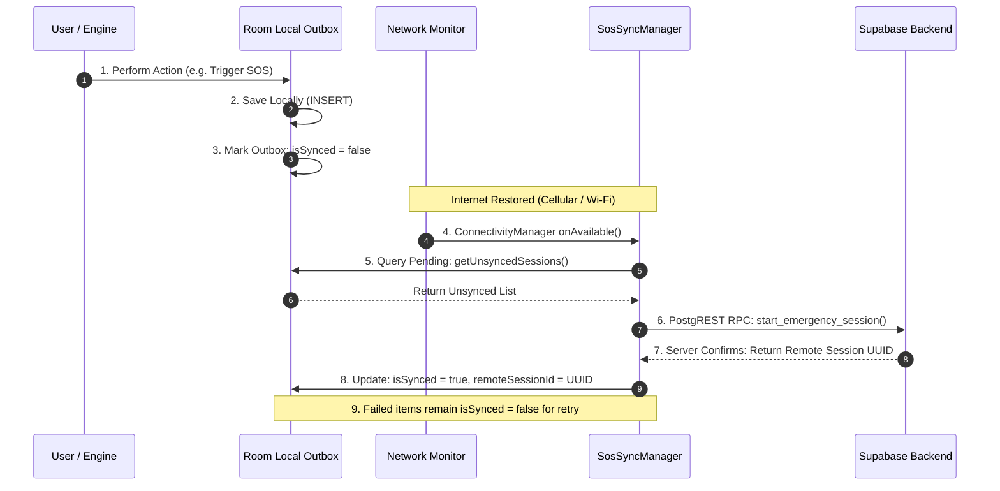

# Drishti AI — Offline-to-Online Synchronization Model

## 1. The 9-Step Outbox Synchronization Lifecycle

Drishti AI implements an outbox pattern for asynchronous data synchronization, ensuring that operations initiated offline are guaranteed eventual consistency on the cloud backend.



---

## 2. Network State Detection (`SosSyncManager.kt`)

Rather than inefficiently polling the network in loops, Drishti AI registers an active callback with Android's system `ConnectivityManager`:

```kotlin
fun startNetworkMonitoring() {
    val cm = connectivityManager ?: return
    val request = NetworkRequest.Builder()
        .addCapability(NetworkCapabilities.NET_CAPABILITY_INTERNET)
        .addCapability(NetworkCapabilities.NET_CAPABILITY_VALIDATED)
        .build()

    cm.registerNetworkCallback(request, object : ConnectivityManager.NetworkCallback() {
        override fun onAvailable(network: Network) {
            Log.i(TAG, "Internet connectivity restored. Triggering outbox sync.")
            triggerSync()
        }
        override fun onLost(network: Network) {
            Log.d(TAG, "Network connection lost.")
        }
    })
}
```

---

## 3. Atomic Outbox Reconciliation Loop

The synchronization loop is thread-safe and non-blocking, operating on `Dispatchers.IO`:

1. **Concurrency Lock:** An `AtomicBoolean(false)` prevents multiple parallel sync jobs from executing concurrently.
2. **Session Promotion:** Unsynced local sessions without a `remoteSessionId` are created remotely via `supabaseRepo.startEmergencySession()`.
3. **Telemetry Batching:** Once the remote session UUID is established, all pending telemetry breadcrumbs linked to that session are bulk-inserted into `public.emergency_telemetry`.
4. **Local Confirmation:** Upon HTTP 200/201 confirmation, the local rows are updated with `isSynced = true`.
5. **Backoff on Failure:** If an HTTP error occurs (e.g., HTTP 503 or socket timeout), the loop halts and leaves the remaining items marked `isSynced = false`, ready for the next network event.

---

## 4. Current Implementation vs. Roadmap

| Subsystem Component | Current Verified Status | Architectural Details |
| :--- | :---: | :--- |
| **Local Relational Outbox** | **Implemented & Verified** | Room tables for sessions, telemetry, and delivery receipts |
| **Network Event Listener** | **Implemented & Verified** | `ConnectivityManager.NetworkCallback` with internet capability validation |
| **Atomic Sync Engine** | **Implemented & Verified** | `SosSyncManager` executing on isolated coroutine scope |
| **WorkManager Background Queue** | **Planned Roadmap** | Migrating standalone callback to `WorkManager` Periodic WorkRequests for OS-managed retries when the app process is terminated |
