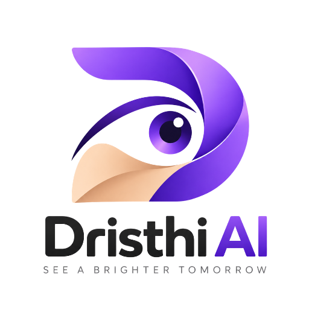
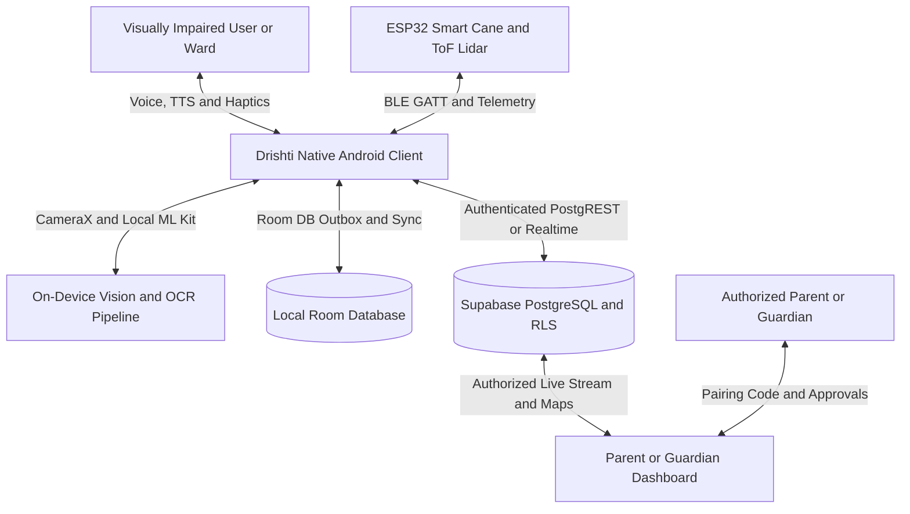

<div align="center">
  

  # Drishti AI — Project Overview
  ### *See a Brighter Tomorrow*
</div>

## 1. Executive Summary

**Drishti AI** is an advanced assistive technology and smart mobility ecosystem engineered to empower visually impaired and low-vision individuals to navigate physical spaces independently, access printed information, communicate seamlessly, and maintain a secure emergency lifeline with trusted caregivers and emergency services.

By uniting a native Android application (Kotlin, Jetpack Compose, CameraX, ML Kit, TelecomManager) with custom embedded smart-cane hardware (ESP32-CAM, VL53L0X Time-of-Flight lidar, BLE telemetry, autonomous haptic feedback) and a secure cloud backend (Supabase PostgreSQL, Row-Level Security, Edge Functions), Drishti AI eliminates the fragmentation of existing assistive solutions into a cohesive, voice-first, offline-capable platform.



---

## 2. Problem Statement

Globally, over 253 million people live with moderate to severe visual impairment or blindness. In their daily lives, individuals face persistent, multi-dimensional challenges:

1. **Environmental Navigation & Obstacle Awareness:** Traditional white canes detect obstacles only at ground level within immediate physical reach. Overhead obstacles (tree branches, open vehicle tailgates, hanging signboards) and rapid approach hazards frequently result in head and upper-body injuries.
2. **Access to Information & Text Recognition:** Conventional computer vision tools are either high-latency, cloud-dependent, or overwhelmed by visual clutter, making reading prescription bottles, street signs, transit markers, or restaurant menus slow and unreliable.
3. **Telephony & Communication Barriers:** Mobile touchscreen dialing and caller identification are complex under high cognitive load. Existing screen readers can be cumbersome to operate during an incoming telephone call, especially when distinguishing critical contacts from automated spam or fraud.
4. **Emergency Telemetry & Caregiver Anxiety:** When a blind individual experiences distress, loss of orientation, or a fall, standard mobile SOS triggers fail to transmit physical context (such as cane obstacle distance, battery status, or precise GPS accuracy) to parents or guardians in real time.
5. **Software Fragmentation & Network Vulnerability:** Assistive features are typically scattered across 4 to 6 separate applications that break completely when cellular connectivity drops.

---

## 3. Project Objectives

Drishti AI was conceived to overcome these barriers through concrete technical objectives:

* **Voice-First & Multilingual Interaction:** Support intuitive, hands-free conversational control in English, Hindi, and Marathi across navigation, calling, vision, scheduling, and device telemetry.
* **Autonomous & Connected Smart Cane:** Augment traditional white canes with millimeter-accurate Time-of-Flight (ToF) obstacle distance sensing (10 Hz cadence), autonomous handle vibration alerts, and low-energy BLE telemetry streaming.
* **On-Device Vision & OCR Perception:** Provide real-time camera-based printed text recognition (ML Kit) with intelligent text deduplication, perspective distance estimation, and tactile feedback without streaming user video to external servers.
* **Hands-Free Telephony & On-Device Contact Resolution:** Identify incoming callers via local `ContactsContract` queries, announce names via Text-to-Speech (TTS), and enable voice-activated answer, reject, mute, and speaker control via `TelecomManager`.
* **Two-Sided Live Guardian Lifeline:** Facilitate cryptographic pairing between wards and approved guardians, streaming live GPS coordinates, battery levels, cane telemetry, and emergency alerts backed by strict PostgreSQL Row-Level Security (RLS).
* **Conversational Scheduling & Alarms:** Enable full voice creation of daily reminders and calendar events, persisting them locally via Room with reliable `AlarmManager` wakeup execution.
* **Offline-First Resilience:** Prioritize local execution for vision, cane alerts, calling, and scheduling. Implement local outbox queues to synchronize telemetry and event data with the backend once internet connectivity is restored.

---

## 4. Intended Users & Personas

Drishti AI establishes two clearly separated user personas enforced at the database, business logic, and UI levels:

### 4.1 Drishti Ward (Visually Impaired User)
* **Profile:** Blind, visually impaired, or low-vision user seeking physical mobility and daily autonomy.
* **Primary Interfaces:** Voice commands (wake-phrase or on-demand mic), TalkBack-compatible high-contrast touch controls, camera viewfinder with spoken feedback, and haptic vibrations.
* **Sovereignty:** The ward retains absolute authorization sovereignty: pairing codes are generated by the ward, and the ward can approve, reject, or unilaterally revoke any guardian's access at any time.

### 4.2 Approved Parent / Guardian
* **Profile:** Trusted family member, caregiver, or support network member.
* **Primary Interfaces:** Visual monitoring dashboard rendering Google Maps live tracking, battery percentage, cane connection telemetry, emergency status indicators, and historical logs.
* **Access Scope:** Strictly read-only access to live location and emergency telemetry, conditioned entirely upon active ward authorization validated by database RLS policies.

---

## 5. Core Architectural Principles

```
+-----------------------------------------------------------------------------------+
|                               DRISHTI AI CORE PRINCIPLES                          |
+-----------------------------------------------------------------------------------+
| 1. Accessibility First | TalkBack semantics, high-contrast palette, haptic cues   |
| 2. Offline-First Ops   | Local Room storage, on-device OCR/STT, outbox sync queue |
| 3. Privacy & Safety    | Zero private cloud video, RLS tenancy, ward sovereignty  |
| 4. Empirical Rigor     | No synthetic claims; verified on physical target devices |
+-----------------------------------------------------------------------------------+
```

1. **Accessibility First:** Every UI component adheres to Material 3 accessibility guidelines, providing accessible touch targets ($\ge 48 \times 48\,\text{dp}$), high-contrast palettes, logical focus orders, and rich audio/haptic feedback loops.
2. **Offline-First Operation:** Critical safety features (obstacle sensing, emergency siren, local contact dialing, local OCR text extraction, scheduled alarms) operate autonomously without internet access. Local actions persist to Room and synchronize upstream via `SosSyncManager`.
3. **Privacy & Security by Design:** Zero video streaming to third-party cloud APIs. All camera frames are analyzed on-device. Personal contacts stay sandboxed on the phone. Database access is guarded by cryptographic pairing codes and row-level authorization.
4. **Engineering Rigor & Verification Honesty:** Documentation strictly separates verified physical implementations from prototypes or planned roadmap items.

---

## 6. 🏆 Hackathons & Achievements

Drishti AI has been presented and validated across competitive hackathons, providing empirical feedback to refine our hardware-to-cloud assistive architecture.

<div align="center">
  <table>
    <thead>
      <tr>
        <th align="center" width="33.3%">💡 <b>Hack4Innovation</b></th>
        <th align="center" width="33.3%">⚡ <b>AI-thon 2.0</b></th>
        <th align="center" width="33.3%">🔥 <b>Code Apex 3.0</b></th>
      </tr>
    </thead>
    <tbody>
      <tr>
        <td align="center">
          <sub><b>📍 Mumbai, MH</b></sub><br />
          
        </td>
        <td align="center">
          <sub><b>📍 Sangamner, MH</b></sub><br />
          
        </td>
        <td align="center">
          <sub><b>📍 VIT Pune, MH</b></sub><br />
          
        </td>
      </tr>
      <tr>
        <td align="left" valign="top">
          <b>🏅 Grand Finalist Stage</b>
          <p>Presented the vision-first assistive pipeline and embedded smart-cane telemetry to the jury.</p>
          <hr />
          <sub>👑 <b>Team Leader:</b></sub><br />
          <b>Suyesh Sonawane</b><br />
          <sub>Android Developer & Researcher</sub>
        </td>
        <td align="left" valign="top">
          <b>🥈 1st Runner Up Winner</b>
          <p>Awarded <b>1st Runner Up</b> for demonstrating offline multilingual speech commands, obstacle ranging, and caregiver emergency lifeline.</p>
          <hr />
          <sub>👑 <b>Team Leader:</b></sub><br />
          <b>Pranit</b><br />
          <sub>Web Application Developer & Tester</sub>
        </td>
        <td align="left" valign="top">
          <b>🏆 Grand Finalist Selection</b>
          <p>Selected as finalists for engineered synergy uniting ML Kit OCR, telephony, and smart-cane sensing.</p>
          <hr />
          <sub>👑 <b>Team Leader:</b></sub><br />
          <b>Vedika Chandratre</b><br />
          <sub>Database Management Specialist & Researcher</sub>
        </td>
      </tr>
    </tbody>
  </table>
</div>

> [!TIP]
> ### 🌟 Our Journey
> Each hackathon has helped the Drishti AI team strengthen its technical skills, collaborate across development and research, and advance its assistive technology solution. Our goal is to build a more accessible and independent experience for visually impaired users through AI, Android development, and smart-cane hardware integration.

---

## 7. Project Team and Responsibilities

Drishti AI is developed by a multidisciplinary team working across Android development, cybersecurity, embedded hardware, database management, web development, testing, and research.

### 7.1 Chetan Gavali

**Role:** Android Security Tester & Hardware Developer

**Responsibilities:**

- Perform security testing of the Android application.
- Identify potential application vulnerabilities and authentication weaknesses.
- Test role-based access control and authorization workflows.
- Develop and integrate embedded hardware components for the Drishti smart cane.
- Work with ESP32, VL53L0X distance sensors, and related IoT components.
- Support hardware-to-Android communication and telemetry integration.
- Test emergency SOS and smart-cane functionality.
- Contribute to system integration, security validation, and technical documentation.

### 7.2 Suyesh

**Role:** Android Developer & Researcher

**Responsibilities:**

- Develop and maintain Android application features.
- Implement and improve user interfaces and application workflows.
- Research Android development techniques and assistive technologies.
- Support integration of voice commands, accessibility features, and application modules.
- Investigate technical issues and contribute to feature testing.
- Document implementation approaches and research findings.

### 7.3 Vedika Chandratre

**Role:** Database Management Specialist & Researcher

**Responsibilities:**

- Support database schema design and management.
- Maintain and organize application data structures.
- Research database technologies and suitable data-management approaches.
- Assist with authentication-related data and parent/guardian relationship records.
- Support database integrity, access-control policies, and data consistency testing.
- Document database architecture and research findings.

### 7.4 Poonam Sapte

**Role:** Web Application Tester & Researcher

**Responsibilities:**

- Test web application functionality and user workflows.
- Identify and document defects and unexpected behavior.
- Perform authorized web application security and usability testing.
- Research web technologies, testing methodologies, and relevant security practices.
- Prepare test cases, record findings, and support issue verification.
- Contribute to technical reports and research documentation.

### 7.5 Samyak

**Role:** Web Developer & Tester

**Responsibilities:**

- Develop and maintain web application components.
- Implement website interfaces and application functionality.
- Test web features, forms, navigation, and responsive layouts.
- Identify and resolve implementation defects.
- Collaborate with the testing team to verify fixes.
- Support web application integration and technical documentation.

### 7.6 Pranit

**Role:** Web Application Developer & Tester

**Responsibilities:**

- Develop and maintain web application features and interfaces.
- Implement responsive layouts and user-facing functionality.
- Test web application workflows, forms, navigation, and cross-device compatibility.
- Identify, document, and help resolve software defects.
- Perform functional and regression testing.
- Collaborate with the web development team to verify fixes and improve application quality.
- Contribute to technical documentation and web technology research.

---

## 8. Team Collaboration

The team works collaboratively to develop and evaluate Drishti AI as an assistive technology platform. Responsibilities span Android software, embedded hardware, database systems, web applications, testing, cybersecurity, and technical research.

Team members may collaborate across modules when integration, debugging, testing, or research requires shared effort.
