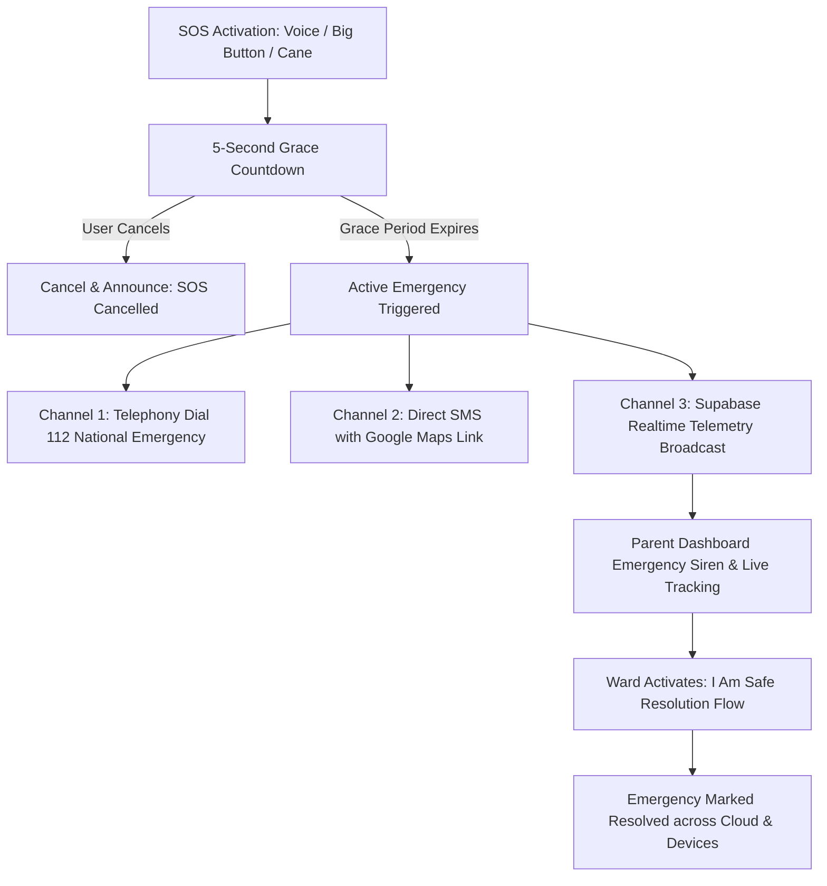

# Drishti AI — Emergency SOS & Caregiver Lifeline

## 1. Emergency SOS Subsystem Overview

During moments of sudden disorientation, physical fall, medical distress, or personal threat, visually impaired individuals require an emergency mechanism that is instantaneous, fault-tolerant, and informative to rescuers.



---

## 2. Multi-Modal SOS Activation

Drishti AI supports three distinct activation paths:
1. **Multilingual Voice Command:** Spoken phrases such as *"Emergency help!"*, *"Send SOS"*, *"मदद करो!"*, or *"तातडीची मदत!"* match the high-priority `ActionRegistry.TRIGGER_SOS` action.
2. **Accessible Full-Screen Surface:** A persistent $72 \times 72\,\text{dp}$ Emergency Red button (`#D32F2F`) located on the main screen, accessible via TalkBack double-tap or direct tactile locate.
3. **Smart Cane Hardware Trigger:** Optional hardware button or sudden obstacle collision alert streaming over BLE.

---

## 3. 5-Second Grace Period & Cancellation Guard

Accidental emergency dispatches cause caregiver panic and waste emergency responder resources. Drishti AI enforces a strict **5-second grace countdown**:

* **Audio Cadence:** TTS announces seconds aloud: *"Emergency SOS activating in 5... 4... 3... 2... 1."*
* **Haptic Acceleration:** The phone vibration motor ticks with increasing tempo ($1\,\text{Hz}$ at 5s, accelerating to $4\,\text{Hz}$ at 1s).
* **Single-Tap Cancel:** The entire screen transforms into a high-contrast cancellation target (`#1F1F1F` Graphite background with `#FAFAF8` text: *"Double Tap Anywhere to Cancel"*). Touching the screen immediately aborts the alert and announces: *"Emergency alert cancelled."*

---

## 4. Multi-Channel Dispatch Protocol

When the countdown expires, Drishti AI fires a coordinated multi-channel response:

### 4.1 Channel 1: National Emergency Services (Dial 112)
The application initiates an Android telephony intent to dial India’s unified emergency number (**112**) or the regional emergency service, enabling immediate voice contact with emergency dispatchers.

### 4.2 Channel 2: Direct Emergency SMS Dispatch (`EmergencySmsSender.kt`)
Using Android `SmsManager`, the application sends structured text messages to all configured emergency contacts:
```text
EMERGENCY ALERT from Drishti AI!
Rohan requires immediate assistance.
Last GPS Location: 20.0092N, 73.7671E (+/- 30m)
Live Map: https://maps.google.com/?q=20.0092,73.7671
Battery: 41% | Cane Distance: 450mm
Time: 13:05 IST
```

### 4.3 Channel 3: Cloud Real-Time Telemetry Stream
An active emergency session is staged in the local Room outbox and uploaded to Supabase via `start_emergency_session()`. The parent monitoring dashboard immediately sounds an audible alarm, highlights the map in red, and displays the child's live trajectory.

---

## 5. "I Am Safe" Resolution Workflow

To formally conclude an emergency:
1. The user taps the green **"I Am Safe"** button or speaks: *"I am safe now"* / *"आपातकाल समाप्त करो"*.
2. The client calls the `end_emergency_session` RPC, which sets `status = 'resolved'` and records the resolution timestamp.
3. The parent dashboard clears the red emergency banner and returns to standard monitoring mode.
