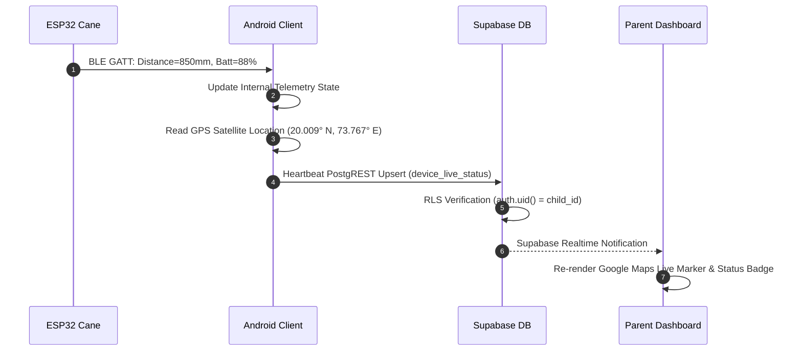
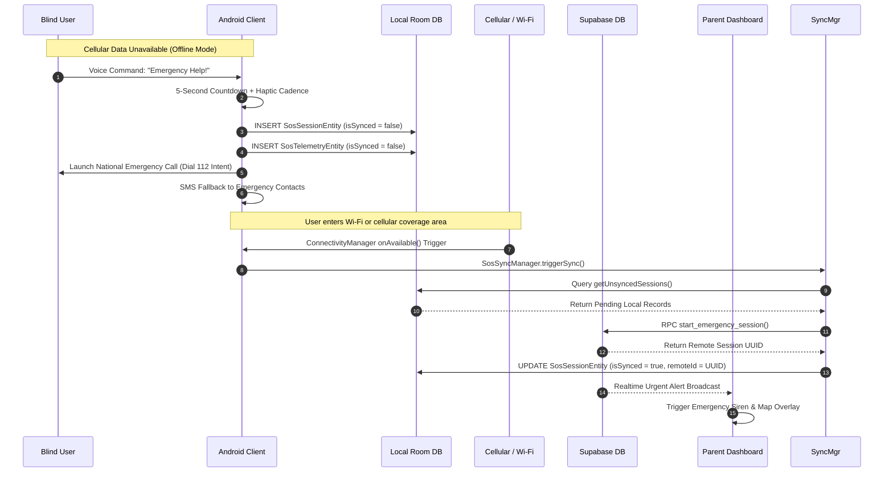

# Drishti AI — System Architecture

## 1. Architectural Topology Overview

Drishti AI is structured as a resilient, multi-tier distributed ecosystem designed to operate under variable connectivity conditions while guaranteeing hard real-time safety at the edge.

```mermaid
flowchart TB
    subgraph EdgeHardware["1. Embedded Edge Tier (ESP32 Smart Cane)"]
        Sensor[VL53L0X ToF Lidar] -->|I2C @ 10Hz| MCU[ESP32 Microcontroller]
        MCU -->|GPIO High| Motor[Handle Haptic Motor]
        MCU -->|PWM| Buzzer[Auditory Buzzer]
        MCU -->|Nordic UART Service| BLE[BLE 4.2 GATT Server]
        Cam[OV2640 Camera] -->|DVP Interface| MCU
        MCU -->|Wi-Fi Station 802.11 b/g/n| Stream[/stream MJPEG Server]
    end

    subgraph AndroidHost["2. Mobile Client Tier (Kotlin & Jetpack Compose)"]
        BLE <-->|GATT NUS Client| BleMgr[Esp32BleManager]
        CamX[CameraX Engine] -->|ImageAnalysis @ 6 FPS| MLKit[ML Kit Text & Object Models]
        Mic[Microphone Hardware] -->|AudioRecord| VoiceMgr[MicrophoneCoordinator & STT]
        Telephony[Cellular Radio] -->|PHONE_STATE Broadcast| CallMgr[IncomingCallDetector & CallMgr]
        
        BleMgr --> Bridge[HardwareDistanceBridge]
        MLKit --> Pipeline[PerceptionPipeline]
        VoiceMgr --> Router[VoiceRouter]
        CallMgr --> Identity[CallerIdentityResolver]
        
        Bridge --> Risk[HazardRiskEngine]
        Pipeline --> Risk
        Risk --> AudioHaptic[TTS Engine & HapticAlertManager]
        
        Router --> ActReg[ActionRegistry]
        ActReg --> EvtMgr[EventManager & AlarmScheduler]
        ActReg --> SOS[EmergencyManager]
        
        EvtMgr <-->|Room CRUD| RoomDB[(Room Database: DrishtiDatabase)]
        SOS <-->|Outbox Staging| RoomDB
        
        RoomDB <-->|NetworkCallback Trigger| SyncMgr[SosSyncManager]
    end

    subgraph CloudBackend["3. Cloud Backend Tier (Supabase PostgreSQL + RLS)"]
        SyncMgr <-->|HTTPS / REST PostgREST| SupaClient[Supabase Client SDK]
        SupaClient <--> Auth[Supabase Auth / GoTrue]
        SupaClient <--> DB[(PostgreSQL 15 Database)]
        
        DB --- RLS{Row-Level Security Policies}
        RLS --- Profiles[public.profiles]
        RLS --- Pairing[public.parent_child_relationships]
        RLS --- LiveStatus[public.device_live_status]
        RLS --- SOSTelem[public.emergency_telemetry]
        
        Router -.->|HTTPS Fallback Q&A| EdgeFunc[Supabase Edge Function: voice-ai]
        EdgeFunc -.-> Gemini[Google Gemini 1.5 Flash]
    end

    subgraph GuardianClient["4. Guardian Tier (Parent Application)"]
        DB <-->|Supabase Realtime WebSocket| GuardianLive[Guardian Realtime Channel]
        GuardianLive --> ParentVM[ParentDashboardViewModel]
        ParentVM --> ParentUI[Jetpack Compose Dashboard & Google Maps]
    end
```

---

## 2. Architectural Tier Breakdown

### 2.1 Tier 1: Embedded Edge Tier (ESP32 Smart Cane)
* **Microcontroller Unit (MCU):** Espressif ESP32 dual-core Xtensa LX6 operating at 240 MHz with 520 KB SRAM and 4 MB PSRAM.
* **Firmware Runtime:** FreeRTOS dual-core multitasking:
  * **Core 0:** Wi-Fi HTTP MJPEG video encoding server (`/stream` and `/jpg`) and authenticated client session validation.
  * **Core 1:** Deterministic 10 Hz VL53L0X sensor sampling, rolling median outlier filtering, handle vibration PWM generation, and Nordic UART Service (NUS) BLE GATT advertising.
* **Autonomous Safety Guarantee:** Handle vibration and buzzer alerts fire on Core 1 within $\le 50\,\text{ms}$ of an obstacle breach without waiting for BLE acknowledgement or Android host processing.

### 2.2 Tier 2: Mobile Client Tier (Native Android Application)
* **Application Framework:** Native Android using Kotlin 1.9, Jetpack Compose, Material 3, and Kotlin Coroutines/Flows.
* **Architecture Pattern:** Clean MVVM (Model-View-ViewModel) with Unidirectional Data Flow (UDF).
* **Local Persistence Layer:** Room relational database (`DrishtiDatabase`) maintaining local outbox tables for SOS sessions, telemetry snapshots, delivery receipts, guardian device caches, and calendar events.
* **Perception & Telephony Engines:**
  * **CameraX + ML Kit:** On-device visual inference at 6 FPS with `STRATEGY_KEEP_ONLY_LATEST` backpressure handling.
  * **TelecomManager + ContactsContract:** Local phone state listener, zero-cloud contact resolution, and automated `CALL_COMMAND_LISTENING` microphone mode during ringing.
* **Outbox Synchronizer (`SosSyncManager`):** Monitors network connectivity via `ConnectivityManager.NetworkCallback`. When internet returns, it uploads pending Room records to Supabase and updates local records with remote confirmation IDs.

### 2.3 Tier 3: Cloud Backend Tier (Supabase PostgreSQL + RLS)
* **Database Engine:** PostgreSQL 15 managed by Supabase, enforcing relational integrity across 21 domain tables.
* **Row-Level Security (RLS):** 100% of tables enforce RLS policies restricting read, write, and update permissions across 5 actor personas (`ward`, `approved parent`, `pending parent`, `unrelated user`, `anon`).
* **Stored Procedures (RPCs):** 8 security-definer functions executing atomic operations, such as cryptographic pairing code generation (`generate_pairing_code`), rate-limited submission (`submit_pairing_code`), and emergency lifecycle tracking (`start_emergency_session`).
* **Edge Functions:** Serverless Deno runtime hosting the `voice-ai` gateway, mediating conversational AI queries via Google `gemini-1.5-flash` while keeping API keys safely off the mobile client.

### 2.4 Tier 4: Guardian Tier (Parent Dashboard)
* **Interface:** Jetpack Compose dashboard featuring real-time Google Maps integration.
* **Data Ingestion:** Authenticated Supabase Realtime WebSocket subscription listening directly to `public.device_live_status` and `public.emergency_telemetry`.
* **Security Validation:** Guardian JWT tokens are continuously validated against `parent_child_relationships` where `status = 'approved'`. If a ward revokes access, database triggers instantly revoke the guardian’s channel read access.

---

## 3. End-to-End Data Flow Scenarios

### 3.1 Normal Online Operation & Live Telemetry Flow



### 3.2 Offline Emergency Trigger & Reconnection Flow


