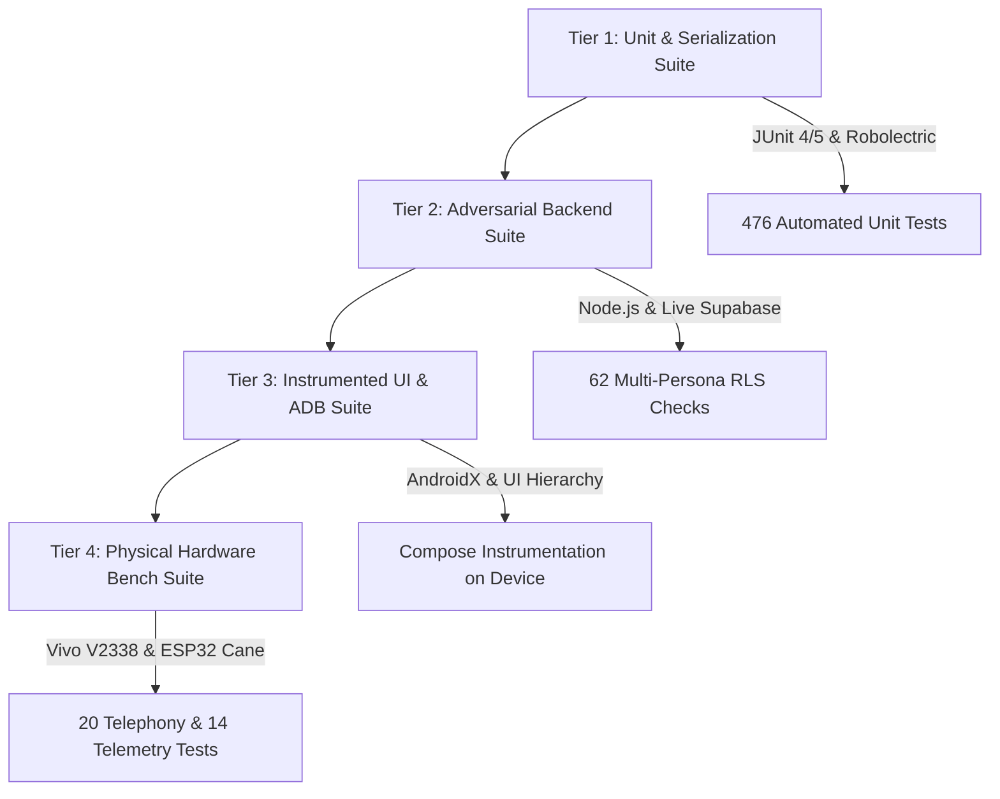

# Drishti AI — Verification Strategy & Quality Gates

## 1. Multi-Tier Testing Methodology

To guarantee reliability across critical assistive, telephony, and emergency features, Drishti AI employs a four-tier verification framework:

---

## 2. Test Tiers Breakdown

### 2.1 Tier 1: Automated Unit & Serialization Testing
* **Test Runner:** Gradle `testDebugUnitTest` using JUnit 4/5 and Robolectric for fast headless Android framework mocking.
* **Scope:**
  * Regex token matching in `DefaultVoiceCommands.kt`.
  * Conversational temporal slot parsing in `EventTimeParser.kt`.
  * Room database migration assertions and DAO query testing.
  * Moshi / Kotlin serialization round-trip tests matching remote Supabase schema columns.

### 2.2 Tier 2: Adversarial Database & Security Suite
* **Test Runner:** Standalone ESM Node.js test harness (`scripts/comprehensive_database_audit_suite.mjs`).
* **Target:** Live remote Supabase instance (`https://jbefmywcskovcsdcmdjb.supabase.co`).
* **Personas Tested:** 5 simultaneous authenticated actors (`ward`, `approved parent`, `pending parent`, `unrelated attacker`, `anon`).
* **Assertions:** 62 security assertions validating tenant data isolation, code expiration, brute-force rate-limiting, and ward revocation sovereignty.

### 2.3 Tier 3: Instrumented UI & Framework Testing
* **Test Runner:** AndroidX Test Orchestrator executing on connected physical Android hardware.
* **Scope:**
  * Compose UI hierarchy validation and TalkBack semantic tree dumps.
  * SharedPreferences persistence and settings screen navigation.
  * `AlarmManager` pending intent registration.

### 2.4 Tier 4: Physical Hardware & Real-World Field Bench
* **Target Devices:**
  * **Device A:** Physical Vivo V2338 (Android 16 / API 36, Device ID `10BEAS227B0055N`).
  * **Device B:** Cellular test phone for incoming call generation.
  * **Hardware Cane:** ESP32-CAM with STMicroelectronics VL53L0X ToF sensor and handle haptic motor.
* **Scope:**
  * End-to-end incoming call detection, TTS announcement, and hands-free answering in English, Hindi, and Marathi.
  * End-to-end two-sided live GPS and cane telemetry streaming to parent dashboard.
  * VL53L0X obstacle ranging bench tests across surface types and distances.

---

## 3. Mandatory Quality Release Gates

Before tagging any candidate build as ready for release:
1. **Automated Unit Tests:** 100% passing rate across all unit test suites (`./gradlew testDebugUnitTest`).
2. **Security & Key Audit:** Zero private API credentials, Supabase `service_role` secrets, or personal phone numbers committed to git or compiled into APK assets.
3. **Physical Hardware Validation:** All critical telephony, SOS, and telemetry flows must pass empirical verification on physical hardware.
4. **Honesty Verification:** Any prototype feature relying on synthetic training data or lacking physical sensors must be clearly labeled as experimental or blocked.
